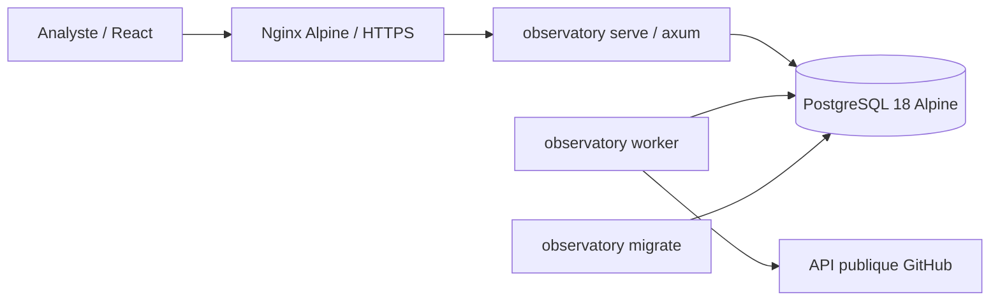

# GitHub Investigation · Observatory

Plateforme d'investigation des relations entre comptes et dépôts **publics** GitHub. Un compte ou un dépôt sert de point de départ ; chaque scan conserve ses observations, ses preuves et sa couverture. Le corpus est mutualisé, avec des droits par investigation.

**Version 0.3, destinée à un pilote.** Le backend (API, worker, migrations, CLI) est écrit en **Rust** ; l'interface en React/TypeScript. Tous les services tournent dans des images **Alpine**, sans root, avec un système de fichiers en lecture seule. PostgreSQL est la source de vérité. Le nom Observatory est provisoire.

## Démarrer sous Linux

Prérequis : Docker Engine avec Docker Compose v2 ou ultérieur. Ni Rust, ni Node, ni PostgreSQL à installer sur le serveur.

```sh
sh scripts/setup.sh
docker compose up --build -d --wait
docker compose exec api observatory create-user analyste
docker compose exec api observatory demo --login analyste
```

Le mot de passe est demandé sans écho : au moins 14 caractères. Ouvrir **http://localhost:8088**. La démonstration est facultative et ne contient que des données fictives.

Sur un serveur distant, utiliser d'abord un tunnel SSH :

```sh
ssh -L 8088:127.0.0.1:8088 utilisateur@serveur
```

Pour l'accès de l'équipe, configurer le proxy HTTPS selon le [guide de déploiement Linux](docs/DEPLOIEMENT_LINUX.md). Le port HTTP reste lié à la boucle locale. Les secrets générés se trouvent dans `.secrets/`, exclu de Git et des images. Une installation 0.1 se met à jour sans perte : voir la section « Mettre à jour » du guide.

## Fonctionnalités

- Comptes nominatifs, sessions, rôles responsable/analyste/lecteur et révocation des accès par investigation ; échecs de connexion limités par poste et par compte.
- Création de dossiers, notes, scans publics bornés, suivi des états et annulation.
- Graphe interactif 3D à forces, avec bascule 2D, filtres, voisinage et export PNG ; comptes, dépôts, issues et pull requests reliés par les propriétaires, forks, contributions, auteurs et étoiles observées dans les événements publics.
- Index PostgreSQL partagé, identités GitHub stables, preuves JSON dédupliquées et fidèles à la réponse GitHub, recoupements entre dossiers auxquels l'analyste a accès.
- Consultation d'un scan antérieur et comparaison des liens observés. Une absence n'est jamais présentée comme une suppression certaine.
- Import en flux des anciens `users_db.json` et `repos_db.json`, sans lecture des pickles ni du fichier de token historique.

Le collecteur explore un voisinage borné : il ne parcourt pas encore récursivement tout un réseau. Les planifications récurrentes, la détection de communautés, les vues temporelles globales et la qualification en charge restent à construire : voir l'[état d'implémentation](docs/IMPLEMENTATION.md) et la [feuille de route](docs/FEUILLE_DE_ROUTE_INVESTIGATION.md).

## Architecture



| Répertoire | Contenu |
|---|---|
| `crates/observatory-domain` | Règles pures : seeds, pagination GitHub, JSON canonique des preuves, lecture des instantanés. Testées et soumises au fuzzing. |
| `crates/observatory` | API HTTP, worker, collecteur, stockage, sécurité, migrations, CLI. |
| `migrations/` | Migrations SQL numérotées, vérifiées par empreinte. |
| `frontend/` | Interface React/TypeScript (Vite, ESLint, Prettier, Vitest). |
| `fuzz/` | Cibles cargo-fuzz et graines de corpus. |
| `docs/` | Déploiement, décisions d'architecture (`adr/`), cadrage et feuille de route. |

## Développer et valider

```sh
make test     # tests Rust contre un PostgreSQL jetable + contrôles du frontend, dans Docker
make check    # même chose avec rustup et Node 24 installés localement
make e2e      # parcours navigateur Chromium/Alpine sur la pile démarrée
```

La CI GitHub bloque sur : rustfmt, clippy pedantic sans avertissement, tests unitaires et d'intégration PostgreSQL avec plancher de couverture, test de migration depuis le commit de base, Prettier, ESLint, TypeScript, Vitest, cargo-deny, npm audit, revue des dépendances ajoutées, construction des images, smoke test et parcours navigateur. CodeQL et le fuzzing tournent sur chaque pull request et chaque semaine. Le détail est dans [CONTRIBUTING.md](CONTRIBUTING.md).

## Documentation

- [Contribuer](CONTRIBUTING.md) · [Sécurité](SECURITY.md) · [Journal des versions](CHANGELOG.md)
- [Déploiement, HTTPS, administration, sauvegarde et mise à jour](docs/DEPLOIEMENT_LINUX.md)
- [Utiliser l'atelier graphe](docs/ATELIER_GRAPHE.md)
- [État livré et validations](docs/IMPLEMENTATION.md)
- [Travail restant, mots-clés configurables et feuille de route](docs/FEUILLE_DE_ROUTE_INVESTIGATION.md)
- [Cadrage complet et architecture cible](docs/PROJET_INVESTIGATION_GITHUB.md)
- [Inventaire historique](docs/INVENTAIRE_HISTORIQUE.md) · [Alignement avec CTIParsor](docs/ALIGNEMENT_CTIPARSOR.md)
- Décisions : [0001 socle Alpine/PostgreSQL](docs/adr/0001-socle-alpine-postgresql.md) · [0002 backend Rust](docs/adr/0002-backend-rust.md) · [0003 migrations](docs/adr/0003-migrations-versionnees.md) · [0004 échecs de connexion](docs/adr/0004-limitation-des-echecs-de-connexion.md) · [0005 collecte économe](docs/adr/0005-collecte-econome.md) · [0006 profils et listes](docs/adr/0006-profils-et-listes-versionnes.md) · [0007 découverte GitHub](docs/adr/0007-decouverte-github.md) · [0008 évaluation et triage](docs/adr/0008-evaluation-et-triage.md)

## Licence

[Apache-2.0](LICENSE). Les données historiques de `ctimap-tool/`, les captures locales et les secrets ne font pas partie du dépôt.
