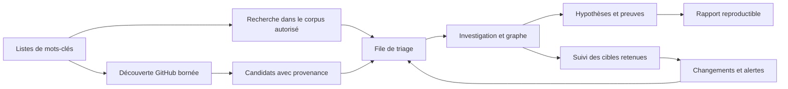

# Observatory — ce qu'il reste à construire

**État de référence : 11 octobre 2026, après livraison du graphe 3D/2D.**

Ce document transforme les besoins du projet en travaux d'implémentation. Il distingue les fonctions présentes, les améliorations nécessaires au pilote d'équipe et les extensions intéressantes. Il complète le [cadrage initial](PROJET_INVESTIGATION_GITHUB.md), l'[état livré](IMPLEMENTATION_V0_1.md) et le [guide du graphe](ATELIER_GRAPHE.md). Pour décider des prochains lots, utiliser cette feuille de route plutôt que les estimations initiales faites avant développement.

**Recommandation : construire d'abord la chaîne « mots-clés → résultats expliqués → triage → investigation → suivi ».** Elle apportera davantage à l'analyste qu'un nouveau changement de moteur graphique. La reprise des collectes, les droits et les migrations doivent progresser avec cette chaîne.

Toutes les fonctions décrites comme proposées restent à développer. Aucun suivi automatique, aucune recherche GitHub ni aucune notification n'est activé par ce document. Les seuils et charges sont des propositions, pas des capacités mesurées.

## 1. Résultat attendu

Un analyste doit pouvoir partir d'un compte, d'un dépôt ou d'un thème, retrouver les observations déjà disponibles, explorer des relations pertinentes, conserver ses hypothèses et recevoir les changements utiles. Un second analyste doit pouvoir comprendre les conclusions, leurs sources et leurs limites sans refaire la collecte.

Les exigences confirmées restent : GitHub public, une équipe d'environ 20 analystes, accès contrôlé par dossier, corpus réutilisable, scans datés, Linux AlmaLinux/Debian/Ubuntu et **Alpine pour tous les services**. PostgreSQL demeure le stockage de référence. Les comptes et dépôts sont les **nœuds** du graphe ; les interactions sont ses **arêtes**.

Une correspondance textuelle, une star ou une proximité graphique est un indice de recherche. Une qualification « développeur de malware » doit rester une conclusion argumentée de l'analyste, distincte des observations automatiques.

### Parcours cible

## 2. Inventaire des écarts

L'inventaire est fondé sur la lecture de `investigator/`, du schéma, des tests, du frontend et des documents locaux. Il ne constitue pas un audit de sécurité ni un nouveau test de charge.

| Domaine | Présent dans le code | Travail restant |
|---|---|---|
| Dossiers | Création, membres, trois rôles, notes | Modification, archivage, plusieurs seeds, responsable métier, statut et objectifs |
| Identités | IDs GitHub stables, identités historiques provisoires | Historique d'alias, transferts, résolution réversible des identités provisoires |
| Collecte | Compte/dépôt, métadonnées, dépôts possédés, contributeurs, forks, issues/PR, événements partiels | Profils configurables, README, commentaires/reviews, expansion et reprise par page |
| Budget | Plafond par scan, attente de quota, limitation partagée | Budgets par type d'API, réservations par dossier, équité et coût prévisionnel |
| Jobs | File PostgreSQL, leases, génération, annulation | Checkpoints, retries contrôlés, mutualisation des demandes, scheduler |
| Recherche | Filtre de liste et filtre de graphe sur un scan | Recherche globale autorisée, index texte, requêtes sauvegardées, facettes |
| Mots-clés | Aucun module dédié | Listes, règles, versions, tests, résultats expliqués et réévaluation |
| Graphe | 3D/2D, filtres, voisinage chargé, recherche, dispositions, preuves et PNG | Composition sauvegardée, multi-seeds, chemins, expansion incrémentale, regroupements |
| Temps | Scans datés, comparaison de relations, précision de date | Différences de propriétés/contenu, vue consolidée, connu/observé, suivi d'une relation |
| Analyse | Notes et recoupements soumis aux ACL | Triage, hypothèses structurées, communautés, mesures et évaluation |
| Diffusion | Capture PNG | Rapport avec preuves, export JSON/CSV contrôlé, échanges CTIParsor |
| Authentification | Comptes CLI, sessions, Argon2, CSRF | Administration des comptes, récupération, désactivation, SSO/MFA |
| Exploitation | Compose Alpine, ressources limitées, proxy TLS optionnel | Restaurations exercées, supervision, rétention, qualification 20 analystes et trois OS |
| Livraison | Locks, digests, pytest/Ruff, build TypeScript, E2E local | Migrations successives, contrôles frontend, CI E2E, release et dépôt GitHub |

Limites actuelles à conserver visibles : deux pages de 50 objets par endpoint du profil ; budget de 1 à 50 requêtes par scan ; graphe de 300 nœuds par défaut, plafonné à 500 nœuds et 2 000 liens ; listes limitées à 200 dossiers et 100 scans/notes. Plusieurs milliers de dépôts stockés ne doivent pas signifier plusieurs milliers de nœuds envoyés automatiquement au navigateur.

**Point technique préalable :** `migrate.py` sait actuellement créer/vérifier une unique version 1 avec checksum ; l'API exige aussi cette version. Il faut ajouter une vraie séquence de migrations avant les nouvelles tables, sans modifier le `schema.sql` déjà appliqué. Un mécanisme de version existe, mais l'upgrade v1→v2 n'est pas encore livré.

## 3. Priorités

| Niveau | Signification | Exemples |
|---|---|---|
| P0 | Nécessaire à la fiabilité du prochain lot ou à l'ouverture d'équipe | Migrations, ACL des nouveaux objets, reprise, sauvegarde/restauration, contrôle des budgets |
| P1 | Forte valeur d'investigation ; cible du pilote utile | Mots-clés, recherche, triage, veille, expansion et rapport |
| P2 | Analyse avancée après stabilisation des observations | Communautés, similarité, chemins pondérés, intégration CTI |
| P3 | Option à justifier par un usage et un budget | Assistant IA, stockage graphe dédié, haute disponibilité, index externe |

P0 ne signifie pas qu'il faut terminer toute l'exploitation avant de montrer les mots-clés. Les migrations et droits du lot mots-clés sont ses prérequis immédiats ; la qualification opérationnelle devient bloquante avant l'ouverture à l'équipe.

## 4. Listes configurables de mots-clés — première fonctionnalité métier

### 4.1 Deux usages distincts

| Mode | Entrée | Résultat | Coût et couverture |
|---|---|---|---|
| Analyse locale | Observations déjà indexées et accessibles | Correspondances sur un scan, une période ou les dernières observations | Aucun appel GitHub ; dépend des champs réellement collectés |
| Découverte GitHub | Liste et filtres convertis en requêtes autorisées | Candidats à examiner puis à rattacher à un dossier | Quota de recherche, résultats partiels, enrichissement facturé séparément |

Ne pas activer implicitement la découverte externe en enregistrant une liste. Prévoir « Tester sur le corpus », « Rechercher sur GitHub » et, plus tard, « Planifier ». Lancer une recherche externe ne doit pas déclencher automatiquement une exploration profonde de tous les résultats.

### 4.2 Champs à rechercher

| Champ | Premier lot | Évolution |
|---|---|---|
| Nom du dépôt | Oui ; composant dépôt séparé du propriétaire | Recherche sur aliases datés |
| Description | Oui, lorsqu'elle figure dans l'observation | Historique et comparaison |
| Topics | Oui, si présents ; absence de collecte signalée | Enrichissement ciblé si manquants |
| README | Après ajout du connecteur texte | Révision, chemin, langue et différences entre versions |
| Titres/corps des issues et PR | Lot suivant, à partir des observations disponibles | Commentaires et reviews collectés séparément |
| Profil du compte | Option distincte des règles « dépôt » | Bio et liens publics, avec provenance |
| Noms de fichiers et code | P2, sur cible et budget explicites | Analyse statique inerte, sans clone ou exécution systématique |

Un dépôt décrit par un simple objet imbriqué peut avoir moins de champs qu'un profil complet. Un README non collecté doit donner **« non évalué »**, jamais « aucun mot-clé trouvé ». La recherche dans le corps du README nécessite de conserver le texte, pas seulement son URL. GitHub expose un endpoint dédié au README et des références de contenu ; le connecteur devra conserver la révision et borner les tailles. [Documentation Contents](https://docs.github.com/en/rest/repos/contents#get-a-repository-readme).

### 4.3 Objet « liste »

Une liste possède un ID stable, un nom, une description, un propriétaire, une portée, une version publiée et un état brouillon/active/archivée. Le premier lot utilise une portée **investigation**. Une bibliothèque d'équipe pourra ensuite partager explicitement des listes génériques ; aucune liste confidentielle ne devient globale automatiquement.

Chaque règle possède : ID stable, libellé, termes/expressions, champs ciblés, mode de correspondance, logique de combinaison, exclusions éventuelles, catégorie, priorité de triage, activation et exemples de test.

Fonctions d'interface : création, duplication, édition, désactivation, import/export JSON, aperçu des erreurs, test sur un échantillon, publication d'une version et comparaison entre versions. Une liste publiée est immuable ; une modification crée une nouvelle version. Les anciens résultats continuent de pointer sur leur version d'origine.

### 4.4 Sémantique de recherche

- Premier lot : mots entiers et expressions exactes normalisées ; opérateurs « au moins un », « tous », « aucun ». Les sous-chaînes sont un choix explicite par règle.
- Normalisation versionnée : Unicode NFKC et casse uniformisée ; conserver le texte original et la correspondance des positions pour le surlignage. La suppression des accents reste une option explicite.
- Dans les noms de dépôts, séparateurs `-`, `_`, `.`, `/` traités comme frontières pour les mots. Définir aussi les frontières Unicode du texte ; éviter un comportement dépendant uniquement de `\b`.
- Une expression doit correspondre dans un même champ ; les clauses « tous » peuvent combiner plusieurs champs. Cette distinction apparaît dans l'éditeur.
- Une règle retourne `match`, `no_match` ou `not_evaluated`. Avec des champs manquants, appliquer une logique à trois états : « tous » ne réussit pas si une clause requise est inconnue ; « au moins un » réussit dès qu'une clause est vraie. Une exclusion dont le champ est inconnu empêche de confirmer le résultat lorsqu'elle est obligatoire.
- Une correspondance augmente une **priorité de revue**, pas une probabilité de malveillance. Ne pas compter cent occurrences du même terme comme cent preuves indépendantes.
- Les regex et la recherche approximative restent P2 : moteur et limites de calcul explicites, erreurs compréhensibles, tests de temps maximal. Aucun code Python, SQL ou JavaScript libre dans une règle.

Les exclusions sont locales à une règle ou à une politique explicitement nommée. Un dépôt contenant « research », « educational » ou « malware analysis » ne doit pas être supprimé automatiquement de tous les résultats : conserver le contexte et permettre une décision de triage.

### 4.5 Exemple de liste

Le fichier [keyword-list.example.json](examples/keyword-list.example.json) propose une configuration de départ **illustrative, non encore importable dans l'application**. Il contient des termes tels que `malware`, `ransomware`, `stealer` et l'expression `command and control`, ainsi qu'un indicateur de contexte de recherche. Ils servent à retrouver des sujets pertinents, pas à désigner des comptes malveillants.

Dans ce format proposé, `repository.name` désigne le nom sans le propriétaire ; `repository.topics` est un tableau dont chaque valeur est évaluée séparément. Dans une clause, au moins un terme dans au moins un champ suffit. Une règle combine ses clauses ainsi : un `any` vrai s'il est renseigné, tous les `all` vrais et aucun `none` vrai. Les tableaux de clauses vides n'ajoutent pas de contrainte ; une règle sans clause positive est refusée. Les champs absents rendent la clause indéterminée si aucun champ connu ne la satisfait. Le moteur doit figer cette sémantique et le schéma JSON avant de proposer un import réel.

Exemple de présentation d'un résultat :

> Dépôt `exemple/analyse-malware` — règle « Thèmes malware », liste v3. Terme « malware » trouvé dans le nom. Observation du 11 octobre ; règle exécutée le 12 octobre. README non évalué. Priorité de revue : normale. Preuve et extrait disponibles.

Conserver séparément : dépôt, observation source, champ, terme, extrait, positions, hash de preuve, version de liste, version du moteur, date d'exécution et éventuelle décision d'analyste. La date d'une réévaluation ne remplace jamais la date d'observation.

### 4.6 Résultats et triage

La file présente : dépôt/compte propriétaire, règles déclenchées, extraits, contexte, première/dernière observation, fraîcheur, couverture et dossiers accessibles liés. Filtres par liste/version, terme, topic, langage, relation, statut, date et analyste assigné.

États proposés : **nouveau → à examiner → pertinent / non pertinent / à surveiller**. « Non pertinent pour cette investigation » n'est pas une attestation de sûreté globale. Une liste d'exclusion de triage doit avoir une portée, une raison, un auteur et, si nécessaire, une expiration ; elle masque une notification, pas la preuve historique.

Une occurrence inchangée à chaque scan met à jour la dernière observation sans créer une nouvelle tâche. Une nouvelle version de contenu, une nouvelle règle pertinente ou un changement significatif peut rouvrir le triage selon la politique choisie. Réévaluer l'historique avec une nouvelle liste doit être une action explicite, bornée et annulable.

### 4.7 Critères d'acceptation du premier lot

| Scénario | Résultat attendu |
|---|---|
| `malware` dans `analyse-malware` | Correspondance et surlignage du composant dépôt |
| `rat` en mot entier dans `strategy` | Aucune correspondance |
| `RANSOMWARE` avec règle insensible à la casse | Correspondance, extrait original préservé |
| `command and control` réparti entre deux champs | Pas de correspondance d'expression |
| README non collecté | Non évalué, motif affiché |
| Terme trouvé dans un dépôt de recherche | Résultat expliqué, pas de qualification malveillante automatique |
| Modification de liste v1→v2 | Résultats v1 conservés ; nouvelle exécution identifiée v2 |
| Deux scans du même contenu | Pas de doublon de triage, observations toujours traçables |
| Dossier non autorisé | Aucun résultat, extrait, compteur ou règle privée révélé |
| Règle invalide ou import trop gros | Refus avant exécution, erreurs localisées |
| Ancien snapshot importé aujourd'hui | Dates d'observation et d'évaluation distinctes |

## 5. Recherche et découverte de dépôts

### Recherche dans le corpus

Créer une recherche paginée sur les données autorisées : nom, alias, description, topics, README et contenu sélectionné. Ajouter facettes, tri par fraîcheur, comptes associés, nombre de relations par type et requêtes sauvegardées. La recherche peut cibler les dernières observations ou une période ; son mode temporel doit être visible.

PostgreSQL fournit une recherche plein texte et des index de similarité via `pg_trgm`. Les utiliser comme présélection, puis appliquer le moteur de règles exact au contenu retenu pour ne pas confondre pertinence textuelle et respect d'une règle. Le choix des index et analyseurs doit être mesuré sur le corpus. [Recherche plein texte](https://www.postgresql.org/docs/18/textsearch.html), [pg_trgm](https://www.postgresql.org/docs/18/pgtrgm.html).

**Choix proposé : rester sur PostgreSQL pour ce lot.** Un index Elasticsearch ou autre devient un prototype justifié par des mesures de pertinence/latence, avec compatibilité Alpine, reconstruction de l'index et synchronisation des ACL démontrées. Le moteur de rendu 3D n'impose aucune base graphe spécifique.

### Découverte externe

Un formulaire transforme les termes en requêtes de recherche de dépôts, avec aperçu : champs, forks inclus/exclus, propriétaires, langage, dates et budget. Inclure les forks doit être un choix visible : GitHub demande des qualificatifs dédiés pour les inclure. Les recherches peuvent cibler le nom, la description ou le README et des topics. [Recherche de dépôts](https://docs.github.com/en/search-github/searching-on-github/searching-for-repositories).

La REST Search API plafonne une recherche à 1 000 résultats et peut signaler `incomplete_results`. Elle possède des limites distinctes de la collecte ordinaire. Conserver requête exacte, API/version, pages, tri, horodatage, couverture et réponse source. Affiner une recherche trop large en sous-requêtes documentées et budgétées ; ne jamais annoncer un inventaire exhaustif de GitHub. [API Search](https://docs.github.com/en/rest/search/search).

Le compilateur de requêtes GitHub est séparé du moteur local : toutes les règles locales ne sont pas traduisibles. Il doit signaler ce qui sera évalué après enrichissement, puis vérifier localement les candidats. Un résultat GitHub `in:readme` reste un candidat tant que le champ nécessaire à notre preuve n'a pas été acquis.

Les recherches planifiées nécessitent une fenêtre avec chevauchement et une déduplication par ID stable. Une recherche uniquement basée sur `created` manque des changements sur les vieux dépôts ; `pushed` ne couvre pas à lui seul toutes les modifications de métadonnées. Combiner découverte récente, relecture bornée et suivi des cibles retenues. En cas de saturation, afficher la couverture et le budget consommé, sans multiplier des identités pour contourner les quotas.

## 6. Collecte plus fiable et plus riche

### Priorité P0 : reprendre sans perdre le fil

Ajouter un checkpoint par cible/endpoint/page : requête suivante, état, pages acquises, compteurs, preuve de page et instant de reprise. Commit atomique de l'ingestion et du checkpoint ; après interruption avant commit, une page peut être relue sans duplication logique. Une requête HTTP peut néanmoins avoir été facturée avant le crash : ne pas promettre « exactement une requête ».

Ajouter retries bornés avec backoff et jitter pour erreurs transitoires, distinction des erreurs de droit/quota/validation, traitement ETag/304 et budget restant visible. Le cache HTTP doit être cloisonné par identité d'accès et représentation ; une réponse 304 peut produire une nouvelle observation liée à la preuve existante. Les budgets ne doivent pas être remis à zéro à chaque retry.

La déduplication du corpus existe ; celle des **demandes de collecte** reste à construire. Séparer le job d'acquisition de ses demandes par investigation. Une annulation ou révocation détache son demandeur sans supprimer le travail nécessaire aux autres. Exposer les résultats uniquement via un rattachement autorisé.

### Profils proposés

| Profil | Contenu | Usage |
|---|---|---|
| Métadonnées | Profil dépôt/compte, propriétaire, topics et état | Découverte à faible coût |
| Texte | Métadonnées + README borné et daté | Mots-clés et contexte |
| Relations | Forks, contributeurs, issues/PR selon budget | Exploration d'un voisinage |
| Collaboration | Commentaires, reviews, auteurs de PR, liens de forks | Étayer les interactions réelles |
| Suivi | Champs/endpoints choisis, collecte différentielle | Cibles retenues |

Chaque profil est versionné avec des limites de requêtes, pages, objets, octets, temps et profondeur. Les connecteurs supplémentaires doivent définir leurs entités, leur direction de relation, leur provenance et leurs états inconnus avant d'être affichés dans le graphe. Un auteur de commit déclaré, un compte lié par GitHub et un auteur de PR ne sont pas des identités interchangeables.

### Stars et disponibilité des sources

Le socle observe certaines stars via les événements publics et ne fournit pas un listing complet. La documentation GitHub annonce des restrictions des listings de stargazers aux administrateurs/collaborateurs à partir de juillet 2026 ; certaines sections génériques restent plus permissives. Prévoir une matrice de capacités testée avec les droits réellement détenus et un état « non disponible », plutôt qu'un connecteur supposé universel. [Restrictions annoncées](https://github.blog/changelog/2026-06-30-upcoming-access-restrictions-to-public-api-endpoints-and-ui-views/), [API Starring](https://docs.github.com/en/rest/activity/starring).

Les compteurs de stars, les événements observés et une liste de personnes représentent trois sources différentes. Aucun échec ou résultat vide ne prouve une suppression. Le modèle communautaire doit fonctionner aussi sans stars, avec forks, contributions, PR, commentaires et reviews disponibles.

## 7. Suivi récurrent et alertes

Ajouter un objet de surveillance attaché à une cible et un dossier : profil, fréquence, priorité, fraîcheur souhaitée, prochain passage, budget et état actif/en pause. Un même dépôt peut être ponctuel dans un dossier et suivi dans un autre.

Le scheduler peut rester un processus Python Alpine utilisant la file PostgreSQL. Il doit empêcher les doublons de créneau, répartir les requêtes, survivre à un redémarrage et ne pas rejouer une semaine entière de scans manqués sans plafond. Les calendriers sont stockés en UTC et affichés dans le fuseau de l'utilisateur.

Alertes utiles : nouveau match, nouvelle relation dans le profil suivi, README modifié, renommage/transfert, nouvelle release ou changement important d'activité. Distinguer une alerte métier d'une collecte devenue partielle ou en erreur.

Commencer par un centre d'alertes dans l'application : état lu/assigné/résolu, regroupement, silence temporaire, raison et lien vers avant/après. Toute notification externe sera une intégration explicite, désactivée par défaut. Recontrôler les ACL à l'envoi et à l'ouverture ; retirer un accès doit arrêter les diffusions futures.

**Acceptation :** deux dossiers suivant la même cible peuvent partager une acquisition sans partager leurs annotations ; un contenu inchangé n'inonde pas la file ; pause et révocation prennent effet ; les quotas sont respectés après redémarrage.

## 8. Un graphe adapté au travail d'investigation

La 3D et la 2D sont déjà disponibles. Leur prochaine évolution doit faciliter le raisonnement et la reprise d'un dossier.

| Fonction | Priorité | Critère d'acceptation |
|---|---|---|
| Plusieurs seeds par dossier | P1 | Un compte et plusieurs dépôts peuvent être explorés ensemble, avec origine de chaque ajout |
| Expansion incrémentale | P1 | Ajouter les voisins d'un nœud conserve les positions et respecte un plafond total |
| Composition sauvegardée | P1 | Réouverture des nœuds épinglés, positions, caméra, filtres, notes et scan de référence |
| Annuler/rétablir les actions visuelles | P1 | Une suppression du canevas est réversible et ne supprime pas les preuves |
| Recherche et filtres serveur | P1 | Une entité hors des 300 nœuds visibles reste trouvable dans le périmètre autorisé |
| Chemins entre deux entités | P2 | Chemins bornés, direction et types de relations indiqués, preuve de chaque arête |
| Voisins communs | P1 | Liste expliquée des comptes/dépôts partagés entre deux seeds |
| Groupements par fork, topic, rôle ou dossier | P2 | Agrégat dépliable, compteurs exacts dans la vue et couverture affichée |
| Vue différentielle | P1 | Nouvellement observé, réobservé et non retrouvé sont distingués ; légende lisible |
| Raccourcis et accessibilité | P1 | Navigation clavier, liste équivalente, contrastes et choix 2D conservés |
| Vue « communautés » | P2 | Affiche un résultat analytique versionné, distinct des positions de la simulation |

Une composition sauvegarde un manifeste : moteur/version, sous-graphe, sélection temporelle, positions, caméra et réglages. À la réouverture, revalider les droits ; un nœud devenu inaccessible disparaît avec un message générique, sans révéler le titre de son dossier.

L'expansion comporte deux actions différentes : « montrer les voisins déjà indexés » et « collecter de nouvelles relations ». La seconde affiche le profil et son budget. Pour un nœud très connecté, proposer filtres et pagination au lieu d'envoyer toutes les relations au navigateur.

Un chemin doit rester à l'intérieur du périmètre autorisé de l'analyse. Deux nœuds publics visibles ne donnent pas accès aux nœuds intermédiaires d'un dossier confidentiel. La proximité calculée par le placement 3D n'est ni une proximité temporelle ni une preuve de collaboration.

## 9. Historique, provenance et reproductibilité

### Historique d'entité

Créer une fiche compte/dépôt avec ses alias, profils observés, relations, textes, listes déclenchées et sources. Comparer les propriétés entre deux observations : description, topics, propriétaire, état archivé, compteurs et contenu du README. Un changement de propriétaire utilise les IDs, pas seulement un chemin `owner/repo`.

Conserver au minimum trois notions : date de l'événement source si connue, date de l'observation par la plateforme, date d'enregistrement. Ajouter explicitement la date d'analyse et la version de règle pour les résultats dérivés.

### Requêtes temporelles

Définir deux vues complémentaires : « observations disponibles pour la période X » et « ce que la plateforme savait à la date Y ». Une vue reconstruite est une approximation à partir d'observations, pas une copie garantie de tout GitHub à un instant passé.

Un snapshot de juin importé en octobre peut enrichir la vue observée de juin ; il ne doit pas apparaître comme connu en juillet. Une plage de validité calculée conserve la méthode et les bornes incertaines. Les comparaisons de couverture doivent précéder les interprétations d'apparition/disparition.

### Preuves

Compléter les preuves avec URL source contrôlée, paramètres utiles, version d'API, profil, horodatage, hash, révision de contenu et couverture. Le hash prouve l'identité du contenu conservé, pas à lui seul son authenticité ni une valeur probatoire juridique.

Pour un rapport, conserver une sélection figée d'observations et d'analyses. Si une politique de rétention purge une pièce, afficher ce qui manque ; ne pas prétendre que le rapport demeure intégralement rejouable. Les preuves partagées ne se suppriment qu'après vérification de toutes leurs références autorisées et politiques de conservation.

## 10. Analyse de communautés et signaux utiles

### Commencer par des analyses compréhensibles

1. Voisins communs entre comptes ou dépôts, séparés par type de relation.
2. Chaînes et familles de forks, avec racine et activités propres quand elles sont observées.
3. Contributions, PR et discussions répétées entre mêmes comptes et projets.
4. Dépôts partageant topics, expressions, README proches ou liens publics ; distinguer copie, thème commun et interaction.
5. Évolution d'un groupe de comptes déjà sélectionné, avec niveau de couverture par période.

Éviter une note opaque unique. Présenter une carte d'indices : relation directe, fréquence observée, proximité textuelle, récence et sources disponibles. Les profils et noms auto-déclarés ne suffisent pas à fusionner deux personnes ; une résolution d'identité doit pouvoir être refusée ou annulée.

### Communautés calculées

Le lot P2 peut comparer une baseline de composantes connexes avec un algorithme de communautés tel que Leiden/Louvain, **sous réserve de prototype et build Alpine**. Le choix final dépendra de la projection et des tests ; aucune bibliothèque native n'est présumée compatible avec musl.

Définir la projection avant l'algorithme : nœuds inclus, période, droits, directions, pondération des types, traitement des forks identiques, bots et hubs. Pour une projection comptes↔comptes, garder les dépôts et observations justifiant chaque lien dérivé.

Les étoiles sont un signal d'intérêt faible ; contributions/reviews peuvent mieux documenter une interaction mais ne prouvent pas une intention malveillante. Réduire l'effet des dépôts extrêmement populaires, plafonner les répétitions et comparer avec/sans bots. Conserver algorithme/version, paramètres, seed aléatoire, manifeste des données et couverture.

**Acceptation :** rejouer un calcul, expliquer un regroupement par ses arêtes sources, constater la variabilité, comparer des paramètres et vérifier que les communautés d'un analyste ne dépendent pas de données confidentielles auxquelles il n'a pas accès.

### Mesurer l'utilité

Constituer un jeu annoté avec projets de recherche, collaborations connues, forks massifs, comptes automatiques et cas ambigus. Mesurer la part de pistes retenues après revue, le temps d'analyse, l'accord entre analystes et la stabilité des groupes. Un taux de rappel global des développeurs de malwares n'est pas mesurable sans population de référence connue.

## 11. Gestion du travail et rapports

### Dossiers et hypothèses

Ajouter titre/description modifiables, état ouvert/en cours/en revue/clos/archivé, priorité, responsable, objectifs, seeds et périmètre temporel. L'archivage ne supprime pas les observations.

Une hypothèse contient une question, des arguments favorables, des éléments contradictoires, les preuves liées, le niveau de confiance et un statut. Les annotations peuvent porter sur une entité, une relation, une observation ou une composition. Conserver un historique des modifications et gérer les conflits d'édition par numéro de version.

Séparer tags automatiques, tags d'analystes et décisions validées. Un lecteur consulte ; un analyste ajoute analyses et collectes autorisées ; le responsable gère les droits et les politiques de son dossier. L'administration technique et la gestion de la bibliothèque d'équipe nécessitent des permissions dédiées, pas une extension implicite du rôle responsable.

### Rapports et exports

Premier format : rapport HTML autonome avec export PDF ultérieur, plus JSON/CSV documentés. Contenu : question, périmètre, dates, méthode, couverture, observations, graphe choisi, hypothèses, incertitudes et références de preuves. Un PNG seul ne suffit pas à transmettre une investigation.

Les exports sont construits côté serveur avec les droits effectifs, enregistrés dans l'audit et soumis à expiration/purge. Revérifier l'accès au téléchargement. Pour CSV, neutraliser les cellules interprétables comme formules ; pour HTML/Markdown, conserver un rendu inerte. Un export déjà téléchargé ne peut pas être révoqué à distance : le produit doit distinguer ce cas d'un lien encore hébergé.

Une intégration CTIParsor pourra ensuite recevoir les faits, références et conclusions via un contrat JSON versionné. STIX/OpenCTI sont des options d'interopérabilité : ne pas transformer automatiquement un compte GitHub en acteur malveillant ni perdre la sémantique des forks/stars pour rentrer dans un format.

## 12. Modèle de données et API à faire évoluer

Les noms ci-dessous sont des propositions de conception, pas des tables ou endpoints existants. Réutiliser le modèle d'observation et les preuves autant que possible.

| Ensemble proposé | Rôle et invariants |
|---|---|
| `investigation_seeds` | Plusieurs points d'entrée, raison d'ajout et auteur |
| `collection_profiles` / versions | Endpoints, limites et paramètres immuables d'un profil publié |
| `collection_jobs`, `collection_requests`, `collection_checkpoints` | Acquisition partagée, demandes cloisonnées et reprise atomique |
| `content_observations` | Champ/path/révision/texte, hash et lien vers observation ; taille et statut de collecte |
| `keyword_lists`, `keyword_list_versions`, `keyword_rules` | Identité de liste, portée, version publiée et AST validé des règles |
| `keyword_runs`, `keyword_matches` | Corpus exact, moteur/version, résultat à trois états, extrait et provenance |
| `discovery_runs`, `discovery_candidates` | Requête externe, couverture, ID stable et décision de rattachement |
| `triage_items`, `triage_decisions` | Assignation et décisions contextualisées, historique, déduplication |
| `watch_targets`, `watch_subscriptions` | Cible technique et politiques de suivi par dossier |
| `alerts`, `notification_deliveries` | Événement, destinataires autorisés, regroupement et état de livraison |
| `entity_aliases`, `identity_resolutions` | Alias datés et résolutions d'identité tracées/réversibles |
| `graph_views`, `hypotheses`, `annotation_revisions` | Compositions et raisonnement de l'équipe |
| `analysis_runs`, `derived_relations` | Calculs rejouables séparés des liens directement observés |
| `export_jobs`, `export_manifests` | Sélection autorisée, fichiers, provenance et expiration |

Éviter de gonfler `entities` avec une seule « description actuelle » qui remplacerait l'historique. L'index de recherche doit être lié à la version de contenu et à sa provenance. Les résultats de règles appartiennent au périmètre où elles sont exécutées, même si le texte public source est dédupliqué.

### Contrats API candidats

| Route indicative | Comportement |
|---|---|
| `GET /api/v1/search` | Recherche autorisée, filtres, mode temporel et pagination par curseur |
| `POST /api/v1/investigations/{id}/keyword-lists` | Création d'un brouillon scoped au dossier |
| `POST /api/v1/keyword-lists/{id}/versions` | Publication d'une version validée avec contrôle de concurrence |
| `POST /api/v1/keyword-lists/{id}/runs` | Analyse locale asynchrone d'une version et d'un corpus définis |
| `POST /api/v1/investigations/{id}/discoveries` | Recherche externe explicitement demandée avec budget |
| `GET /api/v1/investigations/{id}/triage` | Résultats paginés et facettes sans fuite de compteurs |
| `POST /api/v1/investigations/{id}/watches` | Création d'une surveillance bornée |
| `POST /api/v1/investigations/{id}/graph-views` | Sauvegarde d'une composition et de son manifeste |
| `POST /api/v1/investigations/{id}/analyses` | Calcul analytique versionné et annulable |
| `POST /api/v1/investigations/{id}/exports` | Génération contrôlée d'un rapport/export |

Toutes les créations coûteuses utilisent une clé d'idempotence, renvoient un job et acceptent l'annulation. Pagination stable, erreurs structurées, limites de payload et validation de schéma font partie du contrat. Pour un corpus qui change pendant la pagination, fournir une borne d'observation/manifeste plutôt qu'une liste qui saute silencieusement des éléments.

## 13. Accès, exploitation et qualité du projet

### Cloisonnement

Le corpus dédupliqué n'est pas automatiquement un corpus intégralement consultable par tous. Par défaut, conserver la règle actuelle : accès via les investigations autorisées. Un corpus public d'équipe explicitement partagé serait une décision distincte.

Étendre les tests de non-divulgation aux recherches, facettes, listes privées, alertes, caches, calculs, exports et compositions. Un calcul commun ne doit pas laisser deviner un dossier privé à travers un score ou un compteur. Si la collecte est mutualisée, seuls ses faits publics autorisés sont réutilisables ; noms de dossiers, notes et raisons de surveillance restent cloisonnés.

### Identité et audit

Avant ouverture à 20 analystes : administration nominative, désactivation de compte, révocation des sessions, changement/récupération des mots de passe et MFA/SSO si fournisseur disponible. Un éventuel service d'identité ajouté à la plateforme doit aussi satisfaire Alpine ; aucune image non conforme n'est introduite implicitement.

L'audit actuel est un point de départ. Ajouter modifications de règles, décisions de triage, droits, surveillance, exports et opérations d'administration, avec acteur, cible, date, identifiant de requête et métadonnées expurgées des secrets. Séparer les logs techniques des preuves d'investigation et limiter leur accès.

### Contenus et dépendances

La future collecte de texte reste inerte : limites d'octets/durée, pas d'exécution du code collecté, pas de scripts embarqués, pas de chargement automatique d'images ou de liens distants du README. Les parsers et bibliothèques doivent être testés dans Alpine. Tout enrichissement d'URL ultérieur nécessite une politique réseau explicite ; un lien trouvé dans un dépôt n'autorise pas sa visite automatique.

Conserver images épinglées, runtime non root, systèmes de fichiers en lecture seule et secrets hors des livrables. Ajouter scans de dépendances/images, SBOM, attestations, procédure de mise à jour et tests de restauration. Qualifier les extensions analytiques sur la bonne architecture CPU et musl avant adoption.

### Opérations

Définir sauvegarde de PostgreSQL et des futures pièces stockées hors base, chiffrement, rétention, restauration sur hôte vierge, rotation des secrets et runbooks. Fixer RPO/RTO avec l'équipe ; aucune haute disponibilité n'est nécessairement requise pour le pilote, mais la perte de l'hôte doit être récupérable.

Surveiller : ancienneté du plus vieux job, attente quota, durée par endpoint, taux d'erreur, progrès de checkpoints, fraîcheur des cibles, taille des preuves, connexions/verrous PostgreSQL et durée des requêtes. Un worker vivant ne suffit pas à prouver que les investigations avancent.

Ajouter pool de connexions et traitement par lots après mesure. Les limites Compose actuelles sont celles du pilote, pas un dimensionnement validé pour l'équipe. Tester installation, upgrade, restauration et permissions sur AlmaLinux/SELinux, Debian et Ubuntu ; WSL Ubuntu est le seul hôte déjà exercé localement.

### Pratiques CTIParsor à compléter

Conserver développement Docker, tests PostgreSQL isolés, locks et ADR. Ajouter mypy, ESLint, tests frontend utiles, mesure de couverture, E2E en CI, contrats API, tests de concurrence et d'upgrade. Le seuil de couverture doit protéger des scénarios métier, pas seulement augmenter un pourcentage. Les protections de branche, la licence, le nom du dépôt et la publication restent à préparer ; aucun dépôt distant n'est créé par cette feuille de route.

## 14. Lots d'implémentation et dépendances

Charges **indicatives en jours-personne**, comprenant développement, tests et documentation, pour une personne maîtrisant la pile. Elles évaluent le travail restant décrit ici, pas le temps déjà passé. À réestimer après R0 et après le premier test de règles ; l'ampleur des connecteurs et du SSO peut changer les ordres de grandeur.

| Lot | Charge | Dépendances | Livraison et critère de sortie |
|---|---:|---|---|
| R0 — migrations et contrats | 3–5 | Socle actuel | Upgrade v1→v2 testé, schéma de règles et portée ACL définis, ancienne base préservée |
| R1 — mots-clés locaux et triage initial | 7–11 | R0 | Listes versionnées, champs de métadonnées, résultats expliqués, file et tests du §4.7 |
| R2 — collecte reprenable et texte | 8–13 | R0 | Checkpoints, retries, profils, README, tests d'arrêt/reprise et budget |
| R3 — découverte et recherche | 5–8 | R1, R2 | Index local, candidats GitHub, pagination, traduction de règles et couverture |
| R4 — mutualisation et suivi | 6–10 | R2, contrats de triage R1 | Abonnements, scheduler, alertes internes et annulation indépendante |
| R5 — exploration et temps | 9–15 | R2, R3 | Multi-seeds, expansion, compositions, différences et vue temporelle documentée |
| R6 — dossiers et rapports | 6–10 | R1, R5 | Hypothèses, décisions, rapport HTML et exports traçables |
| R7 — analyse de communautés | 8–14 | R5 et corpus évalué | Baselines, projections, paramètres, évaluation analyste et build Alpine |
| R8 — qualification d'équipe | 10–18 | Travail transversal ; sortie après lots retenus | Auth/admin, supervision, restauration, CI/release, charge et matrice Linux |
| R9 — pilote métier | 4–7 | R1–R6 et exigences R8 ; R7 facultatif | Scénarios réels revus, défauts prioritaires corrigés, décision d'ouverture |

**Enveloppe de planification : 66–111 jours-personne**, environ 80–135 avec 20 % de réserve. Ce n'est pas un devis ni un délai calendaire. Le pilote peut exclure R7 ; les idées P3, haute disponibilité, intégrations lourdes et analyse exhaustive du code ne sont pas comprises. Les estimations du cadrage initial ne s'ajoutent pas à celles-ci.

Jalons proposés :

1. **Démonstration métier suivante : R0 + R1.** Une liste configurable produit des résultats datés sur le corpus existant, sans appel GitHub supplémentaire.
2. **Pilote de découverte et veille : R2 + R3 + R4.** README, recherches bornées, reprise et alertes expliquées.
3. **Atelier d'investigation complet : R5 + R6.** Travail sauvegardé, comparaison et rapport partageable.
4. **Ouverture d'équipe : sortie R8 + R9.** Restauration et charge prouvées sur matériel connu ; analyse de communautés ajoutée lorsque les données le permettent.

## 15. Backlog prêt à convertir en issues

Les identifiants `REM-*` désignent le travail restant ; ils ne remplacent pas les anciens tickets de cadrage. Les descriptions détaillées et critères des sections précédentes font partie de chaque issue.

| ID | Priorité / lot | Travail | Critère de clôture principal |
|---|---|---|---|
| REM-01 | P0 / R0 | Migrations successives et compatibilité API | Base v1 montée en v2, checksum v1 inchangé, rollback opérationnel par restauration testé |
| REM-02 | P0 / R0 | Portée et schéma des règles | Contrat versionné, droits et limites validés par tests |
| REM-03 | P1 / R1 | CRUD et versions de listes | Brouillon, publication, duplication, archive et import/export |
| REM-04 | P1 / R1 | Moteur de correspondance | Cas limites du §4.7, résultat inconnu et provenance corrects |
| REM-05 | P1 / R1 | Exécutions locales asynchrones | Idempotence, annulation, progression et corpus figé |
| REM-06 | P1 / R1 | File de triage | Assignation, décisions et déduplication sans perte des observations |
| REM-07 | P0 / R2 | Checkpoints et erreurs transitoires | Worker arrêté/repris à chaque frontière de transaction sans perte logique |
| REM-08 | P0 / R2 | Budgets par profil et ressource API | Pas de dépassement après retry, quota ou redémarrage |
| REM-09 | P1 / R2 | README et documents texte | Texte borné, révision/hash, état non collecté et rendu inerte |
| REM-10 | P1 / R3 | Recherche locale et facettes | Pagination stable, ACL sur résultats/compteurs et historique |
| REM-11 | P1 / R3 | Recherche de dépôts GitHub | Requêtes expliquées, candidats dédupliqués et couverture sauvegardée |
| REM-12 | P0 / R4 | Acquisition mutualisée | Un demandeur peut annuler sans affecter les autres |
| REM-13 | P1 / R4 | Planification | Fréquence, pause, retard et budget persistants |
| REM-14 | P1 / R4 | Alertes internes | Changement significatif, anti-doublon et révocation immédiate |
| REM-15 | P1 / R5 | Multi-seeds et expansion | Conserve le travail visuel et les bornes du graphe |
| REM-16 | P1 / R5 | Sauvegarde de compositions | Réouverture 2D/3D avec manifeste et droits recalculés |
| REM-17 | P1 / R5 | Différences et temporalité | Import tardif, renommage et absence partielle correctement présentés |
| REM-18 | P1 / R6 | Cycle des dossiers et hypothèses | Modification/version, contradictions et archivage consultables |
| REM-19 | P1 / R6 | Rapport et exports | Chaque conclusion retrouve ses observations ; accès contrôlé au téléchargement |
| REM-20 | P2 / R7 | Projections et mesures | Arêtes dérivées explicables et nœuds confidentiels exclus |
| REM-21 | P2 / R7 | Communautés et évaluation | Calcul rejouable, baseline, sensibilité et revue analyste |
| REM-22 | P0 avant équipe / R8 | Comptes, sessions et audit | Désactivation, récupération, rôles et traces des actions critiques |
| REM-23 | P0 avant équipe / R8 | Sauvegarde/restauration et rétention | Restauration sur hôte vierge et pièces/droits réconciliés |
| REM-24 | P0 avant équipe / R8 | Supervision et charge | Rapport 20 sessions, ingestion simultanée et seuils annoncés |
| REM-25 | P0 avant release / R8 | CI et livraison Alpine | Upgrade/E2E, SBOM, contrôles d'images et matrice d'installation |
| REM-26 | P1 / R9 | Recette analystes | Parcours complet accepté, limites connues et priorités suivantes consignées |

## 16. Critères de qualité et recette

### Scénario de recette complet

Créer deux dossiers avec accès différents. Publier une liste, analyser un snapshot, consulter un extrait, classer un résultat puis ajouter le dépôt au graphe. Collecter son README et ses relations avec un budget, interrompre le worker et reprendre. Planifier le suivi, simuler un changement, examiner l'alerte, sauvegarder la composition et produire un rapport. Révoquer un accès, restaurer la base dans un environnement de test et vérifier que droits, preuves et états sont cohérents.

### Couverture technique attendue

| Domaine | Cas à tester |
|---|---|
| Règles | Unicode, champs manquants, opérateurs, exclusions, versions et déterminisme |
| GitHub | Quota, 304, 403/404/429, 5xx, pagination changeante, réponses partielles et formats invalides |
| Concurrence | Deux workers, lease expirée, annulation, double demande et scheduler redémarré |
| Accès | Résultats, facettes, exports, alertes, cache, traversées et analyses sans fuite |
| Temps | Import tardif, renommage, changement de contenu et absence non concluante |
| Frontend | 3D/2D, WebGL indisponible, clavier, sauvegarde et restauration des vues |
| Données | Upgrade depuis v1, références partagées, purge, restauration et rejouabilité |
| Exploitation | Disque plein, PostgreSQL indisponible, token expiré et quota long |

Les tests automatisés utilisent des données synthétiques et des réponses GitHub simulées. Les vérifications réelles de connecteurs sont rares, bornées et séparées ; aucun token n'est requis pour la suite normale.

### Objectifs de performance proposés

Recherche locale p95 inférieur à 1 seconde ; voisinage borné p95 inférieur à 2 secondes ; acceptation d'un job inférieure à 1 seconde. Mesurer les parcours avec 20 sessions pendant ingestion. Les temps de collecte externe dépendent des quotas et ne constituent pas un engagement fixe.

Commencer avec 10 000 dépôts et leurs relations/observations, puis un corpus de stress d'un million de nœuds, dix millions de relations et cinquante millions d'observations si les mesures le justifient. Ces tailles sont des scénarios, pas une capacité acquise. Inclure hubs, forks massifs, périodes longues et ACL hétérogènes. Publier matériel, volumes, concurrence, état des caches, durée et taux d'erreur avec les résultats.

### Définition de « terminé »

Pour chaque fonction : migration testée si nécessaire, contrat d'API, contrôles d'accès, limites de ressources, scénario d'échec/reprise, tests métier, documentation et démonstration sur le parcours cible. Une tâche n'est pas terminée parce qu'un bouton apparaît ou qu'un graphe semble cohérent.

## 17. Ajouts intéressants après le pilote

| Idée | Apport | Conditions et limites |
|---|---|---|
| Collections de règles thématiques | Réutiliser les méthodes de l'équipe | Listes versionnées, tests et faux positifs documentés |
| Profils de collecte par question | Adapter le coût : forks, collaboration, évolution | Éviter un profil « tout collecter » sans budget |
| Similarité de README | Repérer des copies/reprises non liées par fork | Extraits justifiant la proximité ; licences/templates créent du bruit |
| Différences propres aux forks | Distinguer copie inactive et développement spécifique | Révisions et limites de comparaison explicites |
| Liens et observables publics | Croiser URLs/domaines/hashes cités dans le texte | Extraction inerte, provenance ; pas de visite automatique des destinations |
| Connecteur CTIParsor | Relier rapports CTI et observations GitHub | Contrat de données, ACL, provenance et déduplication |
| Import de règles YARA ou analyse statique | Prioriser certains contenus collectés | Périmètre séparé, fichiers autorisés, isolation et budget ; ne remplace pas une sandbox malware |
| Assistant de synthèse optionnel | Aider à rédiger une chronologie sourcée | Après qualité des preuves ; citations obligatoires, contenu traité comme données, aucune action automatique |
| Vues publiques expurgées | Partager une conclusion sans le dossier complet | Sélection explicite, revue, version figée et publication autorisée |
| Base graphe ou index spécialisé | Accélérer un besoin démontré | Benchmark, compatibilité Alpine, coûts d'exploitation et reconstruction depuis PostgreSQL |
| Haute disponibilité | Réduire l'interruption après panne | Besoin RPO/RTO, budget et équipe d'exploitation confirmés |

À éviter au démarrage : crawler récursivement tout GitHub, exécuter les dépôts collectés, importer tous les binaires, conclure automatiquement à la malveillance, imposer une stack supplémentaire pour obtenir un graphe, ou rendre un LLM indispensable à la recherche.

## 18. Décisions à prendre sans bloquer le document

| Décision | Proposition de départ | À confirmer avant |
|---|---|---|
| Première portée des listes | Privées à une investigation, duplication possible | R1 |
| Premiers champs | Nom, description, topics ; README avec R2 | R1/R2 |
| Listes initiales | Quelques thèmes écrits par l'équipe, pas un énorme dictionnaire automatique | Recette R1 |
| Partage des faits | Périmètre autorisé actuel ; corpus global seulement sur décision explicite | R3/R4 |
| Découverte externe | Manuelle, bornée, candidats avant collecte approfondie | R3 |
| Fréquence de surveillance | Quotidienne proposée, modifiable ; priorité et quotas mesurés | R4 |
| Alertes | Application uniquement, regroupement par cible/changement | R4 |
| Infrastructure | Mesurer sur serveur disponible avant achat ou HA | R8 |
| Identité | Réutiliser un fournisseur existant si compatible avec les contraintes | R8 |
| Rétention et disponibilité | Définir durée par donnée et objectifs RPO/RTO | R8 |
| Dépôt GitHub | Nom, propriétaire, licence, visibilité et protection des branches | Publication |

Ces propositions permettent de commencer R0/R1 sans exiger une décision sur tous les futurs modules. Le lot recommandé immédiatement est **migrations + listes de mots-clés locales versionnées + résultats expliqués + triage initial**.

## 19. Références et limites de cette feuille de route

Sources locales examinées : `investigator/api.py`, `collector.py`, `store.py`, `schema.sql`, `migrate.py`, `db.py`, `security.py`, `worker.py`, tests, Compose et documentation. Les validations déjà exécutées sont décrites dans l'[état livré](IMPLEMENTATION_V0_1.md) et l'[atelier graphe](ATELIER_GRAPHE.md) ; elles ne sont pas revendiquées pour les fonctions encore proposées.

Les pages officielles GitHub et PostgreSQL sont liées près des décisions concernées et ont été consultées le 11 octobre 2026. Les capacités d'API doivent être retestées au moment de développer chaque connecteur avec la version et les droits retenus. Les pratiques de développement reprises de CTIParsor sont documentées dans l'[alignement local](ALIGNEMENT_CTIPARSOR.md).

Les estimations, seuils, schémas de tables et routes candidates sont des propositions à affiner. Cette feuille de route ne certifie pas une capacité de production, une compatibilité Alpine des options futures ou la fiabilité d'une attribution de communauté.
