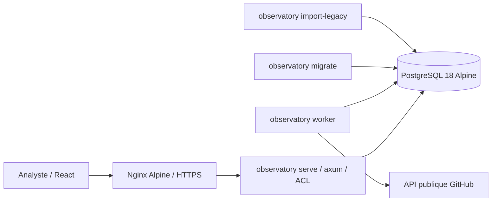

# État d'implémentation — 0.2

État du 11 octobre 2026. Ce document décrit le code livré ; le [cadrage](PROJET_INVESTIGATION_GITHUB.md) décrit la cible plus large et la [feuille de route](FEUILLE_DE_ROUTE_INVESTIGATION.md) le travail restant.

## Architecture livrée

Le backend est un binaire Rust unique, lancé avec des rôles différents dans des conteneurs distincts ([ADR 0002](adr/0002-backend-rust.md)). En développement, l'accès HTTP est uniquement lié à la boucle locale. L'API sert les fichiers compilés de React ; aucun conteneur Node n'est nécessaire en exploitation. La file de jobs et le graphe sont stockés dans PostgreSQL ; Elasticsearch et un moteur graphe séparé ne sont pas nécessaires à ce stade.

## Contrats implémentés

| Domaine | Comportement disponible | Limite actuelle |
|---|---|---|
| Identités | IDs GitHub canoniques, données d'observation conservées dans chaque scan | Résolution automatique des identités historiques provisoires à venir |
| Graphe | Accounts, repositories, issues, PR ; relations orientées et preuve JSON | Voisinage borné d'une seule seed, sans expansion récursive |
| Temps | Observation, enregistrement et date d'événement lorsque disponible ; vue d'un scan et comparaison | Pas encore de requête globale `as_of` / `known_at`, ni d'intervalle de validité reconstruit |
| Corpus partagé | Entités, relations et preuves dédupliquées ; une observation ne recopie pas sa preuve | Deux jobs similaires de dossiers différents peuvent encore consommer deux fois l'API |
| Preuves | JSON stocké tel que reçu, nombres compris ; empreinte identique à la 0.1 | Format d'empreinte figé tant qu'aucune colonne de version n'existe |
| Accès | Responsable, analyste, lecteur ; filtrage des dossiers, preuves et recoupements ; audit des créations, partages, annulations et notes | ACL applicatives ; pas de RLS PostgreSQL ni de multi-tenant |
| Authentification | Argon2id, cookie HttpOnly/SameSite, CSRF, expiration, échecs limités par poste et par compte | Comptes CLI ; pas de SSO/MFA ni de récupération de mot de passe |
| Jobs | File PostgreSQL, `SKIP LOCKED`, lease, génération, annulation, remise en file à l'arrêt du worker | Reprise du profil depuis le début ; checkpoint par page à ajouter |
| GitHub | Budget partagé persisté, attente courte sur place, mise en attente longue, taille/durée bornées, couverture par endpoint | Un seul profil de collecte, deux pages de 50 objets par endpoint |
| Historique | Import JSON en flux, idempotent, date inconnue ou précision au jour | Pickles ignorés, anciennes catégories non reconstruites sans source explicite |
| Schéma | Migrations numérotées vérifiées par empreinte, reprise d'une base 0.1 ([ADR 0003](adr/0003-migrations-versionnees.md)) | Pas encore de procédure de retour arrière automatisée |
| Interface | Dossiers, graphe 3D/2D, preuves, voisinage, filtres, notes, accès, comparaison | 200 dossiers / 100 scans et notes par liste ; pagination à ajouter |
| Durcissement | Images Alpine épinglées, binaire statique, non root, lecture seule, capabilities retirées, secrets séparés | Pas encore de SBOM, de signature d'image ni de filtrage egress du serveur |

Le graphe affiché contient au plus 500 nœuds et 2 000 liens ; la limite par défaut est de 300 nœuds. Le filtre de liste de l'interface porte sur les nœuds chargés ; l'API dispose aussi d'un filtre `q` (motif pris littéralement) et d'un voisinage `focus`, limités au scan autorisé.

La couverture `complete` signifie que l'endpoint demandé n'avait plus de page à parcourir dans ce passage, pas que toutes les relations d'un dépôt ou d'un compte sont connues. `succeeded` désigne l'achèvement du profil borné ; les événements restent une fenêtre partielle. Une star est une interaction observée, pas une preuve d'appartenance à un groupe malveillant.

## Validation de la 0.2

Exécutée le 11 octobre 2026 sous Ubuntu 26.04 (WSL), Rust 1.99.0, PostgreSQL 18.6 et Node 24.

- **Rust** : `cargo fmt --check` et `cargo clippy --all-targets -- -D warnings` (lints `pedantic`) sans remarque ; **66 tests** : 38 unitaires et 28 d'intégration contre PostgreSQL 18 avec authentification SCRAM, chacun dans sa base, avec le rôle applicatif restreint. Ils couvrent les sessions et le CSRF, les droits et la révocation, l'invisibilité des preuves et dossiers non autorisés, la limitation des échecs par poste et par compte, l'idempotence et le plafond de scans, la déduplication, les libellés historiques, la comparaison sans suppression inférée, le refus des objets privés, les bornes du graphe, la collecte complète contre une API GitHub simulée (pagination canonique, lien de pagination étranger, quota, taille, redirection), la boucle du worker et son arrêt en cours de scan, l'import historique, la démonstration, la reprise d'une base créée par la 0.1 et les droits du rôle applicatif.
- **Couverture** des lignes Rust : 88,6 % (`cargo llvm-cov`) ; la CI exige 87 %.
- **Compatibilité** : vecteurs produits par CPython pour la forme canonique des preuves, la clé d'import et un hachage pwdlib ; empreinte de la migration 0001 égale à celle enregistrée par la 0.1.
- **Fuzzing** : quatre cibles cargo-fuzz exécutées localement (plusieurs millions d'entrées chacune). La cible `canonical` a révélé qu'un flottant pouvait changer d'un ULP et qu'un entier au-delà de 64 bits devenait un flottant ; corrigé par `arbitrary_precision`, entrées gardées en régression.
- **Dépendances** : `cargo deny check` (avis, licences, sources) sans exception.
- **Frontend** : Prettier, ESLint, TypeScript et **17 tests Vitest** ; build Vite avec Cytoscape et Three.js en fichiers chargés à la demande.
- **Application réelle**, binaire lancé hors conteneur : migrations 1 et 2, vérification du schéma, création de compte, démonstration ; parcours dans un navigateur (connexion, graphe 3D puis 2D, preuve, recoupement, comparaison, note, accès, déconnexion) sans erreur JavaScript autre que le 401 attendu avant connexion.
- **Collecte réelle** bornée sur `octocat/Hello-World` avec un budget de 6 requêtes : 6 requêtes en 7 secondes, pagination canonique suivie, 100 forks et 100 issues/PR, couverture et statut `partial` corrects ; 227 des 441 observations ne recopient pas leur preuve.
- **Import réel** de l'instantané `corpus-a-2026-06` (83 Mo) : 7 419 comptes et 250 002 dépôts en 2 min 57 s, **9,7 Mo de mémoire maximale** ; le temps est dominé par les allers-retours SQL.

- **Conteneurs Alpine** (Docker 29.8, pile Compose isolée du pilote sous un autre nom de projet) : les 66 tests Rust passent dans l'image de test contre PostgreSQL 18 jetable ; contrôles frontend dans Node Alpine ; pile complète démarrée, `/ready`, page d'accueil, CSP, API en UID 10001 sur Alpine 3.24.2, PostgreSQL non root, `migrate --check`. Image d'exécution : **25,8 Mo**, contre 137,5 Mo pour l'image Python 0.1.
- **Parcours Chromium sous Alpine** (`frontend/e2e.mjs`) réussi en entier : rendu 3D, orbite, clic et preuve, voisinage, export PNG, passage en 2D, filtres, dispositions, zoom, clic sur une relation, chronologie, affichage mobile, repli sans WebGL, déconnexion.

Non exécutés pendant ce lot : proxy HTTPS (`compose.tls.yaml`) avec la configuration 0.2, et montée en version d'une base pilote réelle (prévue avec REM-28 après restauration testée). Les hôtes AlmaLinux et Debian restent à qualifier.

Le jeu de démonstration est fictif. Les données du corpus A servent uniquement à valider le connecteur et l'import : aucune qualification malveillante ne leur est attribuée.

## Prochain lot proposé

La [feuille de route](FEUILLE_DE_ROUTE_INVESTIGATION.md), révisée après la 0.2, détaille et priorise le travail restant (lots R0–R9, backlog REM-01 à REM-31). Elle commence par une restauration testée de la base pilote avant sa montée en 0.2, une file de jobs générique, puis les listes de mots-clés locales avec résultats expliqués et triage ; le cadrage RGPD est lancé en parallèle. Chantiers techniques toujours nécessaires :

1. **Fiabiliser les scans longs** : checkpoint par endpoint/page, ETag, backoff explicite pour erreurs transitoires, reprise sans requêtes déjà consommées, mutualisation de jobs avec ACL indépendantes.
2. **Suivre les dépôts retenus** : abonnement manuel, calendrier, budget par surveillance et mise en pause.
3. **Explorer un réseau plus large** : expansion à la demande, profondeur et nombre de nœuds plafonnés, pagination et filtres côté serveur.
4. **Renforcer le temps** : vue consolidée à une date, distinction connu/observé, renommages et preuve des variations.
5. **Communautés et analyse** : graphes dérivés, motifs, centralité et communautés avec paramètres, provenance et validation analyste. Aucun score automatique ne doit transformer une interaction en attribution malveillante.
6. **Qualifier l'exploitation d'équipe** : tests de charge à 20 analystes, sauvegarde/restauration vérifiée, métriques, SSO/MFA, SBOM et signature des images, insertion par lots pour l'import historique. Matrice Linux réelle : AlmaLinux, Debian et Ubuntu.
