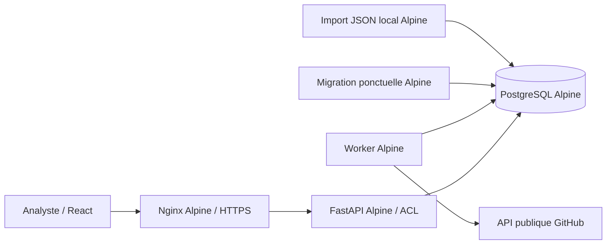

# État d'implémentation — 0.1

État du 11 octobre 2026. Ce document décrit le code livré ; le cadrage général décrit la cible plus large.

## Architecture livrée

En développement, l'accès HTTP est uniquement lié à la boucle locale. L'API sert les fichiers compilés de React ; aucun conteneur Node n'est nécessaire en exploitation. La file de jobs et le graphe sont stockés dans PostgreSQL. Elasticsearch et un moteur graphe séparé ne sont pas nécessaires à cette première tranche.

## Contrats implémentés

| Domaine | Comportement disponible | Limite actuelle |
|---|---|---|
| Identités | IDs GitHub canoniques, données d'observation conservées dans chaque scan | Résolution automatique des identités historiques provisoires à venir |
| Graphe | Accounts, repositories, issues, PR ; relations orientées et preuve JSON | Voisinage borné d'une seule seed, sans expansion récursive |
| Temps | Observation, enregistrement et date d'événement lorsque disponible ; vue d'un scan et comparaison | Pas encore de requête globale `as_of` / `known_at`, ni d'intervalle de validité reconstruit |
| Corpus partagé | Entités, relations et preuves dédupliquées | Deux jobs similaires de dossiers différents peuvent encore consommer deux fois l'API |
| Accès | Responsable, analyste, lecteur ; filtrage des dossiers, preuves et recoupements | ACL applicatives ; pas de RLS PostgreSQL ni de multi-tenant |
| Authentification | Argon2, cookie HttpOnly/SameSite, CSRF, expiration de session, limitation des échecs | Comptes CLI ; pas de SSO/MFA ni de parcours de récupération de mot de passe |
| Jobs | File PostgreSQL, `SKIP LOCKED`, lease, génération empêchant les écritures d'un ancien worker, annulation | Reprise du profil depuis le début ; checkpoint par page à ajouter |
| GitHub | Budgets persistés, attente de quota, taille/durée bornées, couverture par endpoint | Un seul profil de collecte, deux pages de 50 objets par endpoint |
| Historique | Import JSON en flux, hash du manifeste, idempotence, date inconnue ou précision au jour | Pickles ignorés, anciennes catégories non reconstruites sans source explicite |
| Interface | Gestion des dossiers, graphe, preuves, voisinage, filtres de liste, notes, accès, comparaison | 200 dossiers / 100 scans et notes maximum par liste ; pagination à ajouter |
| Durcissement | Images Alpine épinglées, runtime non root, readonly, capabilities retirées, secrets séparés | Pas encore d'audit exhaustif, de signature/SBOM ou de filtrage egress du serveur |

Le graphe affiché contient au plus 500 nœuds et 2 000 liens ; la limite par défaut est de 300 nœuds. Le filtre de liste dans l'interface porte sur les nœuds déjà chargés. L'API dispose aussi d'un filtre `q` et d'un voisinage `focus`, tous deux limités au scan autorisé.

La couverture `complete` signifie que l'endpoint demandé n'avait plus de page à parcourir dans ce passage. Elle ne signifie pas que toutes les relations d'un dépôt ou d'un compte sont connues. `succeeded` désigne l'achèvement du profil borné ; les événements restent une fenêtre partielle. Une star est une interaction observée, pas une preuve d'appartenance à un groupe malveillant.

## Validation effectuée

- Construction des images Python, Node et PostgreSQL Alpine épinglées ; compilation TypeScript/Vite.
- **28 tests pytest** sur une base PostgreSQL isolée : sessions et CSRF, droits et révocation, invisibilité des preuves/dossiers non autorisés, idempotence, limites des jobs, déduplication, labels historiques et recherche dans un ancien scan, comparaison sans inférer une suppression, imports inertes, budget partagé, quota, lease et normalisation des relations.
- Ruff : contrôles de syntaxe, erreurs usuelles et imports passants.
- Une collecte réelle bornée sur le dépôt public de référence du corpus A et un import réel du petit snapshot historique `corpus-a-contributors` : un compte, deux dépôts et deux relations importés. Le premier passage réel a permis de corriger la pagination GitHub vers `/repositories/<id>`. Le passage corrigé a consommé exactement six requêtes, collecté 100 forks et 100 issues/PR, puis indiqué les limites de pagination et de budget ; la vue renvoyée comportait 300 nœuds et 264 liens, avec le signalement de troncature.
- Parcours Chromium sous Alpine : connexion, graphe fictif, ouverture d'une preuve, comparaison, affichage mobile et déconnexion. Captures locales dans `.local/screenshots/`, non publiées.
- Validation locale de la configuration Nginx et d'une session HTTPS avec certificat autosigné de test : connexion, cookie Secure/HttpOnly/SameSite, HSTS, session authentifiée et déconnexion protégée par CSRF. L'installation locale a ensuite été rétablie sur la boucle HTTP ; l'accès depuis Windows a également été vérifié.

Le jeu de démonstration est fictif. Les données du corpus A servent uniquement à valider le connecteur et l'import : aucune qualification malveillante ne leur est attribuée.

Un avertissement de dépréciation Starlette concerne l'usage de httpx par son client de test ; la suite passe. Le frontend charge le moteur 3D dans un bundle séparé ; Vite signale encore la taille des fichiers JavaScript, et le découpage de Cytoscape reste un travail ultérieur. Voir l'[atelier graphe](ATELIER_GRAPHE.md) pour les fonctions 3D/2D et leurs vérifications. La CI GitHub est fournie mais n'a pas été exécutée à distance : aucun dépôt distant n'a été créé pendant ce lot.

## Prochain lot proposé

La [feuille de route actualisée](FEUILLE_DE_ROUTE_INVESTIGATION.md) détaille et priorise le travail restant. Elle propose de commencer par les migrations successives et les listes de mots-clés locales avec résultats expliqués et triage. Les chantiers techniques ci-dessous restent nécessaires ; leur ordre est désormais précisé par les lots R0–R9 de cette feuille de route.

1. **Fiabiliser les scans longs** : checkpoint par endpoint/page, ETag, backoff explicite pour erreurs transitoires, reprise sans requêtes déjà consommées, mutualisation de jobs avec ACL indépendantes. Validation : arrêt du worker au milieu d'une page et reprise déterministe sans doublon ni fuite entre dossiers.
2. **Suivre les dépôts retenus** : abonnement manuel, calendrier, budget par surveillance et mise en pause. Validation : deux investigations abonnées à une même seed partagent une collecte sans partager leurs notes.
3. **Explorer un réseau plus large** : expansion à la demande, profondeur et nombre de nœuds plafonnés, pagination et filtres côté serveur. Validation : dossier de plusieurs milliers d'entités utilisable sans afficher tout le graphe.
4. **Renforcer le temps** : vue consolidée à une date, distinction connu/observé, renommages et preuve des variations. Validation : un scan tardivement importé ne modifie pas ce que l'application prétendait connaître avant son import.
5. **Communautés et analyse** : graphes dérivés, motifs, centralité et communautés avec paramètres, provenance et validation analyste. Aucun score automatique ne doit transformer une interaction en attribution malveillante.
6. **Qualifier l'exploitation d'équipe** : tests de charge à 20 analystes, pool PostgreSQL, sauvegarde/restauration vérifiée, métriques, SSO/MFA, audit des actions critiques, mises à jour et contrôles d'images. Matrice Linux réelle : AlmaLinux, Debian et Ubuntu.

## Écarts aux pratiques CTIParsor encore à combler

Le développement sous Docker, FastAPI/React, la file PostgreSQL, les locks, les migrations contrôlées et les premiers tests sont repris. Restent notamment mypy, ESLint, tests unitaires frontend, mesure de couverture et seuil justifié, CodeQL/fuzzing, SBOM/attestations, tests d'upgrade et réglages de protection du dépôt GitHub. Le seuil de couverture de CTIParsor n'est pas revendiqué pour ce code.
