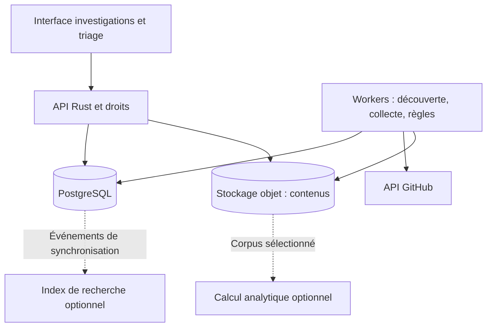

# Proposition — collecte configurable, recherche de code et conservation longue

Date : 12 octobre 2026. Statut : proposition d'implémentation revue le même jour (corrections intégrées, ordre de livraison révisé au §9) ; aucune fonctionnalité activée par ce document.

Ce plan complète la [feuille de route](FEUILLE_DE_ROUTE_INVESTIGATION.md). Il priorise la recherche dans le code, auparavant classée P2, pour découvrir aussi les dépôts sans description. Il ne remplace pas les autres chantiers d'exploitation et d'accès de cette feuille de route.

## 1. Résultat attendu

L'analyste configure ses termes, choisit où chercher, fixe la profondeur et le budget, examine des résultats expliqués, puis suit les cibles retenues. Le système conserve les versions et les preuves utiles sans télécharger plusieurs fois les mêmes contenus.

Trois axes restent indépendants : profondeur des relations, richesse du contenu et ancienneté des versions examinées. Une collecte profonde dans le graphe n'implique pas de télécharger tout l'historique Git.

PostgreSQL reste la source de référence des identités, dossiers, droits, observations et références des pièces. Un stockage objet reçoit les contenus volumineux. Un index externe ou un moteur de calcul sera ajouté seulement si les mesures montrent un besoin.

## 2. Point de départ vérifié

| Présent dans le code | Évolution proposée |
|---|---|
| Interface : budgets 6, 12, 24 ; API : 1 à 50 | Profils versionnés et budgets multidimensionnels |
| Deux pages de 100 éléments par endpoint | Pagination configurable, bornée par le profil |
| Collecte du voisinage d'une cible | Plusieurs seeds et expansion persistée par niveaux |
| Cache cloisonné, ETag, retries, checkpoints | Réutilisation dans les connecteurs de découverte et de contenu |
| Quotas, leases et générations de workers ; rythme partagé par ressource de quota déjà générique (`github_rate_limits` : `core`, `search`, `code_search`, `graphql`, alimentés par les en-têtes et `github-status`) | Jobs génériques, équité entre dossiers ; brancher la réservation existante sur `search` et `code_search` |
| Deux compteurs depuis la 0.3 (ADR 0005) : `requests_used` = quota décompté (une réponse 304 authentifiée est rendue au scan), `coverage.stats.requests` = appels envoyés | Contrat de budget qui nomme explicitement les deux unités |
| Preuves dédupliquées et ingestion par lots | Déduplication des acquisitions et des versions de fichiers |
| Recherche de noms avec pg_trgm | Recherche locale dans les champs et contenus collectés |
| Exemple JSON de listes, non exécutable | Moteur de règles, versionnement, résultats et triage |
| Preuves JSONB et observations par scan | Stockage des contenus, politique de conservation et mesure de croissance |

Références locales : `crates/observatory/src/api/scans.rs`, `collector/mod.rs`, `collector/budget.rs`, `worker.rs`, `store.rs`, `frontend/src/components/ExplorationTab.tsx` et migrations 0001 à 0004 (version 0.3.0). Certaines sections historiques de la feuille de route présentent encore comme futurs des mécanismes déjà livrés ; le code et les ADR récents font foi pour ce plan.

## 3. Parcours proposé

1. Créer ou ouvrir une investigation, ajouter un ou plusieurs comptes/dépôts de départ, ou choisir une recherche thématique.
2. Choisir une liste de termes publiée, ses champs et les sources à consulter.
3. Choisir le contenu à collecter et les relations à explorer.
4. Fixer les limites ; consulter un aperçu des requêtes et du périmètre. Toute estimation de coût porte son incertitude.
5. Lancer ; voir progression, attente de quota, couverture et raisons d'arrêt.
6. Examiner les extraits, versions et liens expliquant chaque correspondance.
7. Retenir une cible, étendre son voisinage ou l'inscrire dans une veille.

Actions distinctes : « Tester dans le corpus », « Découvrir sur GitHub », « Collecter les contenus », « Étendre les relations » et « Suivre ». Enregistrer une liste ne lance pas une collecte. Une recherche ne déclenche un enrichissement automatique que si le profil le prévoit avec son propre budget.

### Configuration de collecte

| Paramètre | Contrat proposé |
|---|---|
| `seeds` | Liste bornée de cibles, dédupliquées par identité stable |
| `max_depth` | 0 = pas d'expansion des voisins ; 1 = relations directes ; 2 = expansion des voisins du niveau 1 |
| `relation_types` | Propriétaires, forks, contributions, issues/PR selon connecteurs disponibles |
| `content_scope` | Métadonnées, README, code sélectionné ; historique dans un lot distinct |
| Limites d'expansion | Nombre total d'entités et de dépôts, voisins par cible et type de relation |
| Limites d'acquisition | Pages par endpoint, fichiers par dépôt, octets par fichier et au total |
| Limites API | Appels HTTP envoyés, consommation REST par ressource et points GraphQL séparés |
| Durée | Travail actif cumulé et échéance absolue, attente de quota comprise pour cette dernière |
| Profil | Version immuable enregistrée avec le lancement ; limites administratives supérieures |

La collecte peut enregistrer le propriétaire d'un dépôt sans explorer ce compte : distinguer un objet reçu dans une réponse d'une nouvelle cible d'expansion. Le budget de requêtes n'est pas une unité de profondeur. Un cache frais peut éviter un appel. Deux unités restent distinctes : les appels envoyés, qui comptent toujours, et le quota décompté par ressource (une validation 304 authentifiée est envoyée mais non décomptée, ADR 0005). Les points GraphQL sont rapprochés du coût retourné par GitHub.

Des profils « Aperçu », « Texte », « Code ciblé » et « Réseau » serviront de préréglages. Les plafonds seront calibrés sur le pilote. Exemple illustratif, pas valeur par défaut : profondeur 2, 500 dépôts, 20 fichiers par dépôt, 250 Mo reçus et échéance de 30 minutes.

## 4. Lots d'implémentation

### Lot 0 — Contrats et mesures de référence

**Travaux.** Mesurer la taille des tables/index, les nouvelles preuves et observations par jour, les octets par collecte, les durées et le taux de réutilisation. Préparer un jeu de test figé : dépôts sans description, sans README, fichiers seuls, forks, doublons, projets de recherche et cas synthétiques. Définir des attentes annotées sans considérer tout le corpus historique comme malveillant.

Documenter les unités de budget, les états de couverture et les dates : événement source, observation, acquisition et évaluation. Corriger les descriptions obsolètes des fonctionnalités déjà livrées dans la documentation concernée.

**Livrables.** Mesures reproductibles, fixtures, contrat de profil et ADR de stockage. Hypothèses de dimensionnement bas/médian/haut, sans capacité annoncée avant mesure. Avant toute migration de la base pilote réelle : restauration vérifiée sur une instance isolée.

**Validation.** Réexécuter une mesure sur le même jeu produit des comptes cohérents ; les imports à dates inconnues ne reçoivent pas artificiellement la date du jour comme date d'observation.

### Lot 1 — Profils et orchestration réutilisable

**Travaux.** Ajouter le modèle de profil et une file de jobs PostgreSQL pour découverte, acquisition et évaluation. Réutiliser les leases, générations, checkpoints, annulation et écritures idempotentes existants. Conserver `scans` comme regroupement métier consultable ; introduire progressivement ses travaux enfants au lieu de réécrire tous les scans historiques.

Ajouter des réservations atomiques pour les limites partagées, un plafond d'appels envoyés et un budget global couvrant les travaux enfants. Brancher la réservation par ressource existante (`reserve_request`) sur `search` et `code_search`, déjà visibles dans `github-status`. Réconcilier les points GraphQL avec le coût retourné. Un plafond en octets nécessite une lecture en flux limitée et une gestion des réservations concurrentes.

Séparer un travail d'acquisition partagé de ses demandes par dossier. Sa clé prend en compte la cible, révision ou fraîcheur, représentation et identité d'accès. L'équité entre dossiers empêche une expansion volumineuse d'occuper toutes les capacités. Une annulation détache un demandeur ; elle n'annule pas le travail nécessaire aux autres.

**Code concerné.** `api/scans.rs`, `worker.rs`, `collector/mod.rs`, `collector/budget.rs`, contrats dans `observatory-domain`, modèle et nouvelles migrations. Interface de configuration dans `ExplorationTab.tsx`.

**Validation.** Plusieurs workers ne dépassent pas ensemble un budget ; arrêt/reprise ne perd aucune page validée ; une révocation d'accès ne révèle aucun travail ou résultat d'un autre dossier ; l'ancien formulaire reste compatible pendant la transition.

### Lot 2 — Termes configurables, recherche locale et triage

**Travaux.** Créer les listes par investigation, versions publiées immuables, import/export JSON et éditeur. Premier moteur : mots entiers, expressions exactes et sous-chaînes explicites ; clauses « au moins un », « tous », « aucun ». Conserver trois résultats : correspondance, absence de correspondance et non évalué.

La normalisation versionnée conserve les positions dans le texte original. Le mode « mot entier » est défini par type de champ : dans le code, les frontières d'identifiants (camelCase, snake_case, `.`, `::`, `->`) font partie du contrat, pas seulement les espaces et la ponctuation du texte. Nom, description et topics sont utilisables immédiatement ; README et code deviennent évaluables lorsqu'ils ont été acquis. Les règles s'exécutent par lots sur un manifeste d'observations figé, avec reprise et annulation.

Ajouter recherche paginée, résultats expliqués, affectation et états de triage. Une occurrence inchangée ne crée pas une nouvelle tâche. Une réévaluation conserve la version de liste et de moteur, la preuve, l'extrait et la date d'évaluation. Les index de recherche produisent des candidats ; le moteur vérifie la sémantique exacte, notamment pour les chaînes de code.

**Code concerné.** Nouveau module de règles dans `observatory-domain`, API de listes/exécutions/résultats, tables dédiées et vues React. Ajouter des URL partageables pour les nouveaux écrans et un contrat API/TypeScript cohérent.

**Validation.** `rat` ne correspond pas à `strategy` en mode mot entier ; une expression ne traverse pas deux champs ; README absent de la collecte = non évalué ; aucune fuite via extraits, facettes ou compteurs ; exécution asynchrone sur le corpus de référence.

### Lot 3 — Découverte GitHub par métadonnées et code

**Travaux.** Connecteurs séparés pour la recherche de dépôts et de code. Le compilateur de requêtes produit un plan inspectable à partir des termes et filtres, avec distinction entre ce qui est recherché à distance et ce qui sera vérifié localement. Une règle locale complexe ne doit pas être traduite en une requête plus restrictive qui élimine silencieusement des candidats.

Demander jusqu'à 100 résultats par page, enregistrer requêtes et sous-requêtes, compteurs, tri, dates, curseurs et réponses sources. Subdiviser les recherches saturées : périodes de création pour les dépôts ; périmètres compatibles tels que comptes, dépôts, langages et tailles pour le code. Ne pas appliquer les filtres de dates de dépôts directement à la recherche de code. Les subdivisions consomment le même budget global et ont un nombre maximal.

GitHub limite les résultats accessibles d'une recherche à 1 000 ; `incomplete_results` signale une réponse potentiellement incomplète. Les quotas authentifiés annoncés sont de 30 recherches/minute, et 10 pour le code. La recherche REST de code considère la branche par défaut et les fichiers de moins de 384 Ko. Ces limites deviennent des états visibles, pas une promesse d'exhaustivité. [Source GitHub](https://docs.github.com/en/rest/search/search).

La recherche de code exige un accès authentifié : sans token, le connecteur est indisponible et l'indique. Elle ne renvoie que des fragments, et seulement avec la représentation `text-match` ; acquérir le fichier complet coûte ensuite des requêtes `core`, à inclure dans l'aperçu du plan et dans le budget. Les forks ne sont indexés que s'ils ont plus d'étoiles que leur dépôt d'origine : un fork piégé y est donc presque toujours invisible. Compléter par la liste des forks des dépôts suivis, déjà collectée, et par une acquisition ciblée de leurs fichiers ; signaler cette limite dans la couverture. Les restrictions annoncées par GitHub en juin 2026 visent les listes d'étoiles et d'abonnés, pas la recherche ([annonce](https://github.blog/changelog/2026-06-30-upcoming-access-restrictions-to-public-api-endpoints-and-ui-views/)).

Ajouter des tests de capacités par endpoint : la syntaxe du moteur web de recherche de code ne doit pas être présumée compatible avec REST. Les filtres de forks et d'archives sont des choix visibles selon les capacités de l'endpoint. [Filtres de dépôts](https://docs.github.com/en/search-github/searching-on-github/searching-for-repositories).

Dédupliquer les dépôts par ID stable, mais conserver les différentes origines de découverte. Un fragment de recherche est une preuve de réponse de recherche ; il ne vaut pas acquisition complète du fichier. Aucun filtre obligatoire sur la description, le README ou le nombre d'étoiles.

**Validation.** Un dépôt synthétique sans description peut être découvert par un fichier ; recherche saturée subdivisée ou explicitement partielle ; quota code distinct ; candidat doublonné fusionné sans perdre les requêtes sources ; frais du plan visibles.

### Lot 4 — README, fichiers et stockage des pièces

**Travaux.** Introduire une interface de stockage de contenus. Premier backend : fichiers adressés par contenu sur un volume dédié, suffisant pour le pilote et pour le développement. Un backend compatible S3 viendra quand les volumes l'exigeront, qualifié avec les contraintes Alpine ; l'édition communautaire de MinIO a été réduite en 2025, Garage ou SeaweedFS sont à évaluer au même titre. Acquérir les README et fichiers sélectionnés à une révision résolue. Détecter les listes de fichiers tronquées, consigner les exclusions de taille et définir les formats acceptés.

Conserver ID dépôt, commit, chemin, identifiant Git du blob, empreinte SHA-256 des octets, taille, format, date et source. Ne pas confondre l'empreinte d'une preuve JSON existante et celle d'un fichier : espaces d'identifiants et versions explicites. Plusieurs chemins ou dépôts peuvent référencer le même objet sans perdre leur provenance.

Ordre d'écriture : déposer l'objet, vérifier taille/empreinte, puis valider la référence SQL et l'observation. Une erreur SQL peut laisser un objet orphelin, nettoyé après délai et vérification des références ; une pièce manquante ne doit jamais être présentée comme disponible. Ne pas simuler une transaction distribuée entre PostgreSQL et le stockage objet.

Les contenus sont examinés comme données inertes : pas de build, installation, hook ou script du dépôt. Le projet cherche des auteurs de logiciels malveillants : les pièces peuvent être du code malveillant et contenir des secrets de tiers. Elles ne sont jamais rendues dans le navigateur (téléchargement forcé, `nosniff`, aucun rendu HTML ou SVG, extraits échappés), sont téléchargées dans une archive protégée, stockées à part du code de l'application, et protégées contre les bombes de décompression. L'antivirus de l'hôte peut les mettre en quarantaine : exclusion documentée ou volume dédié. Le moteur applique les règles aux fichiers et peut combiner des indices, avec justification. Les pages de résultats affichent la couverture : fichiers reçus, examinés, exclus et non accessibles. Les téléchargements passent par les droits du dossier, y compris pour une pièce physiquement mutualisée.

**Validation.** Même fichier stocké une fois et analysé à nouveau seulement si contenu ou règles changent ; texte original récupérable ; panne entre stockage et SQL réconciliable ; révocation effective à la lecture ; limites de taille respectées avant chargement complet en mémoire.

### Lot 5 — Expansion du réseau par profondeur

**Travaux.** Ajouter une frontière d'exploration persistée : cible, niveau minimal atteint, chemin/provenance et état. Parcours par niveaux avec ensemble des cibles visitées ; conserver toutes les relations probantes sans acquérir plusieurs fois le même contenu.

Définir le saut comme une relation métier choisie, notamment dépôt → contributeur → autre dépôt. Les nœuds techniques d'issues/PR ne doivent pas modifier implicitement cette définition. Si une cible est retrouvée par un chemin plus court, mettre à jour son niveau et les expansions encore permises.

Bornes globales et par cible/type de relation ; ordre déterministe et politique visible pour les hubs. Les comptes automatiques (`[bot]`, dependabot, github-actions…) sont exclus de l'expansion par défaut : ils relient des milliers de dépôts sans lien d'enquête. Poursuite manuelle depuis une frontière conservée, sous un nouveau budget explicite. Pagination côté serveur et chargement progressif du graphe : la taille du corpus ne détermine pas la taille du graphe affiché.

**Validation.** Cycle A → B → A terminé ; profondeur 0/1/2 conforme ; un hub ne consomme pas tout le budget ; annulation et reprise stables ; accès au corpus partagé contrôlé à chaque rattachement.

### Lot 6 — Veille et historique sélectionné

**Travaux.** Ajouter des abonnements par cible ou recherche, fréquence, budget et suspension. Le scheduler crée des jobs idempotents ; une période manquée ne déclenche pas une rafale illimitée au redémarrage. Détecter nouveaux fichiers, versions et correspondances pertinentes sans répéter les tâches pour un contenu inchangé.

Combiner découverte récente, réexamen périodique de cibles connues et fenêtres avec chevauchement. `created` ne retrouve pas les changements d'un ancien dépôt ; `pushed` n'est pas un journal de toutes les modifications de métadonnées. Une fenêtre de veille ne doit pas être présentée comme un historique exhaustif.

Ajouter ensuite un mode d'historique Git ciblé : branches/références, période, commits, fichiers, octets et durée bornés. Réutiliser les blobs identiques entre commits. Lister ce qui reste inaccessible ou hors périmètre. Aucun téléchargement intégral de l'historique n'est nécessaire pour le premier pilote de recherche dans le code.

**Validation.** Un changement sur un vieux dépôt suivi est détecté ; une règle nouvelle peut réévaluer des pièces déjà conservées ; un fichier supprimé mais acquis auparavant reste consultable ; le système ne prétend pas retrouver un historique disparu avant acquisition. Les alertes sont d'abord internes à l'application.

### Lot 7 — Conservation longue et qualification de charge

**Travaux.** Mesurer en continu croissance des objets uniques, observations, liens, index, sauvegardes et journaux. Projeter cinq ans à partir de scénarios d'activité, taux de changement et fréquence de collecte. Exemple arithmétique seulement : 10 Go nets/jour donnent environ 18 To en cinq ans, avant sauvegardes/réplication/index ; cela ne constitue pas un dimensionnement du projet.

Définir des politiques distinctes pour cache HTTP, observations, pièces, exécutions et rapports figés. Cinq ans est une cible configurable pour les données retenues, pas une règle implicite pour tous les objets. La suppression d'une pièce partagée vérifie toutes les références conservées et les éventuels gels associés aux dossiers/rapports.

Préparer le partitionnement temporel des tables volumineuses d'observations et de résultats selon les mesures, puis migrer sur copie qualifiée. Garder les catalogues d'identités et les empreintes globales hors de ce partitionnement si nécessaire. PostgreSQL impose des contraintes sur l'unicité des tables partitionnées : conserver l'idempotence en choisissant la clé temporelle et les clés composées, ou une table de déduplication globale adaptée. [Documentation PostgreSQL](https://www.postgresql.org/docs/current/ddl-partitioning.html).

Qualifier ingestion et consultation simultanées, 20 sessions d'analystes, hubs, longues périodes et droits hétérogènes. Paliers indicatifs à ajuster : corpus historique, puis un million d'entités, dix millions de relations et cinquante millions d'observations. Ce sont des jeux de charge envisagés, pas des capacités acquises.

**Validation.** Rapport indiquant matériel, données, concurrence, latences p50/p95, débit, erreurs, mémoire et espace disque ; restauration de PostgreSQL et des pièces avec vérification des références ; objectifs de perte de données et délai de reprise définis puis mesurés. Les mécanismes de sauvegarde/restauration accompagnent le lot 4 dès l'arrivée des pièces, pas seulement ce dernier lot.

## 5. Schéma cible et interfaces

Noms indicatifs, à figer dans les contrats de chaque lot :

| Objets SQL | Responsabilité |
|---|---|
| `collection_profiles`, versions | Périmètre et limites immuables d'un lancement |
| `jobs`, `job_requests`, checkpoints | Travail partagé, demandes autorisées par dossier et progression |
| Réservations/compteurs de budget | Admission atomique et rapprochement avec consommation effective |
| `keyword_lists`, `keyword_list_versions` | Configuration de règles et publication |
| `rule_runs`, `rule_matches`, `triage_items` | Manifeste évalué, explications et décision de revue |
| `discovery_runs`, `discovery_queries`, candidats | Arbre de requêtes, origines, couverture et déduplication |
| `content_objects`, `repository_file_versions` | Pièces physiques et références dépôt/révision/chemin |
| `expansion_frontier` | État du parcours et profondeur |
| `subscriptions`, `retention_policies` | Veille et cycle de vie |

Chaque résultat métier possède un chemin d'autorisation vers une investigation. Le hash d'un contenu ou l'ID d'un job partagé ne confère jamais un accès. Les nouvelles tables n'impliquent pas de dupliquer les identités et preuves déjà disponibles.

API indicative sous `/api/v1` : profils ; listes et versions d'un dossier ; demande d'évaluation ; prévisualisation puis lancement d'une découverte ; liste paginée des résultats ; demande d'enrichissement/expansion ; état/annulation d'un travail ; lecture autorisée d'une pièce ; abonnements. Les opérations longues répondent avec un identifiant de travail. La prévisualisation pure d'un plan n'appelle pas GitHub ; un sondage de volume, s'il est proposé, est une opération budgétée explicite.

## 6. Architecture et conditions d'ajout de composants

La lecture de pièces par l'API implique d'abord une vérification des droits dans PostgreSQL. Les résultats du moteur de recherche restent soumis aux mêmes droits, y compris leurs compteurs et extraits.

| Décision | Déclencheur proposé |
|---|---|
| Garder PostgreSQL pour la recherche initiale | Index et pagination satisfont les usages mesurés |
| Ajouter Elasticsearch ou équivalent | Latence/pertinence de recherche insuffisante après optimisation documentée ; coût et exploitation acceptables |
| Ajouter un index de code dédié (Zoekt ou équivalent) | Recherche locale dans les fichiers trop lente avec `pg_trgm` sur les volumes mesurés ; plus naturel qu'un moteur généraliste pour du code |
| Ajouter Spark ou autre calcul distribué | Réévaluations/analyses dépassent régulièrement la fenêtre allouée malgré traitement incrémental et lots |
| Étudier Hadoop/HDFS | Besoin réel de cette infrastructure ou plateforme déjà exploitée par l'équipe |

Un index externe serait dérivé et reconstructible : journal transactionnel de changements, indexation idempotente, reprise, gestion du retard, suppressions et contrôle des accès. Ni un moteur externe ni sa compatibilité Alpine ne sont considérés comme acquis sans prototype. Le premier pilote reste exploitable sans ces composants.

## 7. Données personnelles et contenus sensibles

Les contenus de code, README et historiques contiennent des données personnelles (noms, adresses e-mail, en-têtes de licence, auteurs de commits) et parfois des secrets de tiers. Leur acquisition et leur conservation relèvent du cadrage RGPD de la feuille de route (REM-30) : finalité, durées par catégorie, procédure des demandes des personnes, validées avec le DPO.

- Le code des lots 4, 6 et 7 peut être livré, mais l'acquisition de contenus reste **désactivée par défaut** tant que REM-30 n'est pas validé ; l'activation est un réglage d'exploitation documenté.
- Les cinq ans de conservation sont une cible à valider dans ce cadrage, pas une valeur par défaut.
- La recherche de dépôts (métadonnées publiques, comme les collectes actuelles) n'est pas concernée par ce verrou ; les fragments de la recherche de code le sont, comme les fichiers.

## 8. Livraison, migrations et tests

Chaque lot donne lieu à des changements révisables : contrat et migration additive, worker/API, interface, tests ciblés et documentation. L'ordre peut être découpé davantage pour garder des revues compréhensibles. Les migrations existantes restent intactes ; utiliser le prochain numéro libre au moment d'implémenter.

L'ADR 0003 impose actuellement un accord exact entre binaire et schéma. Prévoir une fenêtre de maintenance coordonnée API/worker pour une migration, ou implémenter et tester explicitement un protocole de compatibilité avant de promettre un déploiement progressif. Après migration, un ancien binaire n'est pas un retour arrière valable par défaut. Préférer désactivation de la fonctionnalité dans le nouveau binaire, correctif en avant, ou restauration coordonnée testée si nécessaire.

Les backfills volumineux sont des travaux reprenables par lots, séparés du démarrage et des longues transactions de migration. Toute modification des clés de partitionnement ou du stockage d'une preuve est testée sur copie avant bascule ; les données d'origine restent disponibles jusqu'à vérification.

Tests prioritaires : budgets concurrents, pagination/reprise, quotas secondaires et code, saturation des recherches, règles à trois états, déduplication, droits et révocation, pannes entre stockage objet et SQL, cycles du graphe, évolution de versions et purge de pièces partagées. Utiliser GitHub simulé pour les cas limites, puis un petit test de compatibilité réel borné. Exécuter les contrôles Rust, frontend et migration existants lors des changements correspondants.

## 9. Ordre de livraison

Ordre révisé après revue : le jalon B est prioritaire, et rien ne l'oblige à attendre la mutualisation des acquisitions entre dossiers ni l'équité entre dossiers, qui ne se justifieront qu'avec des recouvrements mesurés. Le cache HTTP cloisonné évite déjà une bonne part des téléchargements répétés.

| Jalon | Lots | Résultat utilisable |
|---|---|---|
| A0 — socle minimal | 0 (mesures essentielles), 1 (profils versionnés, plusieurs seeds), 2 (listes de termes versionnées, import/export JSON) | Configurer une collecte et ses termes ; mesurer ce qu'elle coûte |
| B — découverte sans description | 3, 4 (acquisition désactivée par défaut jusqu'à REM-30) | Recherche de dépôts et de code, candidats dédupliqués avec leurs origines, pièces versionnées |
| A — termes sur le corpus | 2 (moteur à trois états, résultats expliqués, triage) | Évaluation des termes sur métadonnées, fragments et fichiers acquis |
| Mutualisation | Reste du lot 1 (jobs génériques, demandes par dossier, équité) | Quand les mesures montrent des acquisitions répétées entre dossiers |
| C — réseau configurable | 5 | Profondeur, types de relations, reprise et plafonds |
| D — suivi dans le temps | 6 | Veille et historique sélectionné |
| E — conservation qualifiée | Finalisation 7 | Projection de capacité, rétention, charge et restauration mesurées |

L'instrumentation commence au lot 0 ; les droits, les sauvegardes et la maîtrise des volumes accompagnent chaque lot. Le jalon E n'autorise pas à remettre ces bases à la fin. Chaque jalon reçoit une estimation avant son démarrage, rapportée à l'enveloppe de la feuille de route (§14) ; le pilote est encore trop petit (quelques scans) pour fonder seul des projections : le banc d'import synthétique et `pg_stat_statements` complètent les mesures.

La recherche de code exige un token GitHub configuré sur le pilote. Les inconnues de dimensionnement à lever au pilote sont le nombre de dépôts suivis, la fréquence, les fichiers/versions conservés, le taux quotidien de changement, le matériel et les objectifs de restauration. Elles conditionnent les plafonds par défaut et un calendrier crédible ; elles n'empêchent pas les premiers lots sur le socle actuel.
