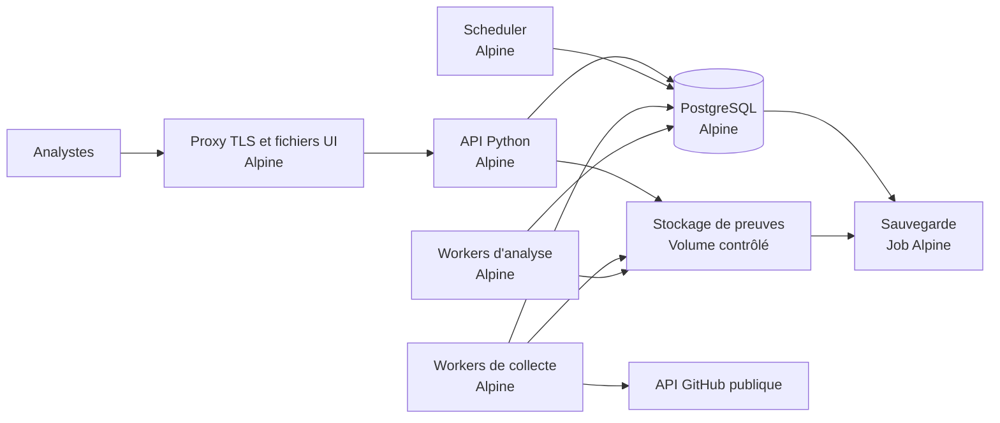
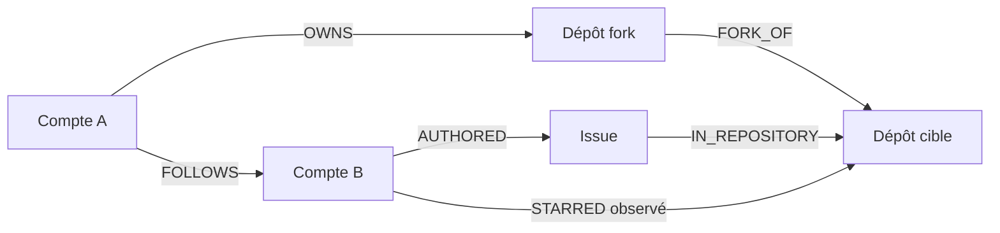

# Plateforme d'investigation GitHub

> Un premier socle est désormais implémenté. Consulter l'[état livré et les validations](IMPLEMENTATION_V0_1.md) et le [guide Linux](DEPLOIEMENT_LINUX.md). Le présent document reste le cadrage initial de la cible. Pour les prochains lots et les estimations du travail restant après livraison du graphe 3D/2D, utiliser la [feuille de route actualisée](FEUILLE_DE_ROUTE_INVESTIGATION.md), qui inclut les listes de mots-clés configurables.

**Cadrage, architecture et feuille de route d'implémentation — version 0.1, 11 octobre 2026**

Statut : proposition de conception intégrant les réponses du porteur du projet. Les composants, performances et échéances ci-dessous sont des recommandations ou objectifs à vérifier ; ils ne décrivent pas une plateforme déjà implémentée.

**Parcours de lecture :** sections 1–6 pour les décisions produit et d'architecture ; 7–10 pour les contrats de données et de collecte ; 11–12 pour l'analyse et l'interface ; 13–17 pour sécurité, développement et validation ; 18–19 pour l'exécution et les arbitrages restants.

## 1. Objectif et décisions de cadrage

Construire une plateforme permettant à une équipe CTI d'explorer les relations entre comptes et dépôts GitHub publics, de repérer des communautés pertinentes pour l'analyse de développeurs de malwares, puis de documenter les hypothèses avec des preuves consultables.

Une investigation commence par un **compte GitHub** ou un **dépôt**. Les résultats alimentent un corpus commun : un même compte ou dépôt peut apparaître dans plusieurs investigations sans être collecté et stocké inutilement plusieurs fois. Les scans successifs permettent de comparer les observations dans le temps.

### Exigences confirmées

| Sujet | Exigence exprimée |
|---|---|
| Finalité | Explorer les communautés autour de comptes et dépôts liés à la recherche sur les malwares |
| Sources | GitHub public uniquement pour le moment |
| Utilisateurs | Une équipe ; environ 20 analystes simultanés |
| Confidentialité | Droits d'accès par investigation |
| Points d'entrée | Compte ou dépôt, avec plusieurs seeds possibles ensuite |
| Volume | De quelques dépôts à plusieurs milliers de dépôts ciblés selon les investigations |
| Mutualisation | Indexation persistante et recoupements entre investigations |
| Temps | Historique des scans et évolution des liens |
| Suivi | Collecte ponctuelle ou surveillance récurrente selon l'intérêt de la cible |
| Interface | Interface graphique pour gérer les investigations et explorer le graphe |
| Déploiement | **Tous les services conteneurisés doivent utiliser Alpine** |
| Méthode de développement | S'inspirer des pratiques vérifiées dans CTIParsor |

Dans la terminologie graphe, les comptes et dépôts sont les **nœuds** ; les interactions sont les **arêtes**. Une issue ou une PR devient aussi un nœud lorsqu'on veut conserver les auteurs, commentaires et preuves qui lui sont associés.

### Recommandation centrale

**PostgreSQL comme source de vérité, graphe explicite et temporel stocké en tables, API Python, interface React/TypeScript, workers séparés et images Alpine.** Les calculs de communautés sont des jobs asynchrones sur des projections définies du graphe. Le navigateur reçoit un sous-graphe borné.

Le premier objectif est une version pilote déjà multi-utilisateur. La montée en charge se mesure ensuite sur les données et le niveau de collecte réels. Des milliers de dépôts ciblés peuvent produire des millions de relations : le nombre de seeds n'est pas un dimensionnement suffisant.

## 2. Ce que l'historique apporte

L'[inventaire détaillé](INVENTAIRE_HISTORIQUE.md) documente les fichiers examinés et les comptages. L'outil existant possède une collecte par rôle, un scoring lexical multilingue explicable, des rapprochements de pseudonymes, des rapports, des comparaisons de populations et une fusion de snapshots.

Deux fichiers représentatifs, le corpus A fusionné et le corpus B, totalisent **1 249 043 entrées de dépôts, forks inclus**, et **84 255 entrées non-forks**, avant déduplication entre fichiers. Le volume historique permet donc un premier benchmark utile. Aucun des cinq fichiers `repos_db.json` examinés ne contient l'ID GitHub des dépôts.

À conserver : analyse hors ligne, justifications du scoring, snapshots historiques et séparation des signaux. À ajouter : identités stables, objets justificatifs des liens, observations datées, contrôle d'accès, indexation commune et recalculs versionnés.

L'historique ne permet pas de reconstituer les dates exactes de toutes les stars ou les issues dont seuls les auteurs ont été conservés. L'import devra rendre ces inconnues explicites.

## 3. Parcours utilisateur et périmètre

### Parcours principaux

1. **Créer une investigation** : titre, objectif, responsable, membres autorisés, compte ou dépôt de départ, profil de collecte et budget. L'écran présente ce qui est déjà disponible dans le corpus et ce qui nécessitera des appels GitHub.
2. **Explorer** : ouvrir le voisinage d'un nœud ; filtrer les types de liens ; étendre un niveau ; consulter les preuves ; épingler une vue ; annoter les éléments pertinents.
3. **Recouper** : retrouver un compte ou dépôt déjà connu ; comparer deux investigations autorisées ; expliquer le recoupement par les IDs et les chemins observés.
4. **Comparer deux scans** : afficher nouveaux liens observés, liens réobservés, changements de propriétés et liens non réobservés avec leur couverture respective.
5. **Suivre une cible** : activer une politique de réactualisation, définir les changements utiles et consulter les deltas. Une nouvelle observation ne déclenche pas automatiquement une accusation ou une alerte critique.
6. **Analyser une communauté** : lancer un calcul sur un sous-graphe et une période ; consulter les membres, les relations structurantes, les biais de collecte et les éléments soutenant une hypothèse.
7. **Exporter** : produire un rapport et un sous-graphe avec la date de vue, les filtres, les limites de couverture et les références des preuves.

### Première version pilote

| Inclus | Différé |
|---|---|
| Comptes individuels, bots et organisations distingués | Résolution automatique des identités entre plateformes |
| Métadonnées de dépôts, forks, contributions, issues, PR et commentaires | Clonage et analyse systématique du code source |
| Stars et watchers selon disponibilité réelle | Exhaustivité globale des stars GitHub |
| Import historique et recherche mutualisée | Crawl de tout GitHub |
| Scans immuables, vues temporelles et comparaison | Reconstruction de périodes antérieures non observées |
| Gestion des droits, notes, hypothèses et exports | Hébergement de plusieurs organisations indépendantes |
| Communautés calculées et examinées par l'analyste | Attribution automatique à des acteurs de menace |
| Profils de suivi ponctuel/récurrent | Exécution de code ou d'échantillons collectés |

Le rapprochement avec les anciens corpus de pseudonymes reste un **module optionnel**, séparé du graphe factuel. Il ne conditionne ni la collecte ni la navigation.

## 4. Choix de stockage et de moteur graphe

| Option | Intérêt | Contraintes | Décision proposée |
|---|---|---|---|
| PostgreSQL, tables de nœuds/arêtes/observations | Transactions, intégrité, ACL, historique et recherche dans un même système | Les parcours denses et profonds doivent être bornés ; analytics séparées | **Socle du pilote et première cible de production** |
| PostgreSQL + Apache AGE | Requêtes de graphe avec une extension dédiée | Compatibilité version PostgreSQL, compilation Alpine, migrations et sauvegardes à valider | Prototype comparatif seulement si les mesures justifient Cypher ou un moteur dédié |
| Elasticsearch | Recherche documentaire et agrégations avancées | Service supplémentaire ; distribution Alpine à qualifier ; synchronisation et exploitation | Hors première version compte tenu de la contrainte Alpine stricte |
| Base graphe séparée | Parcours spécialisés et écosystème d'algorithmes | Double stockage, contrôle d'accès, synchronisation temporelle et compatibilité Alpine | Réévaluation sur benchmark, sans choix de produit prématuré |

PostgreSQL peut exprimer des parcours récursifs et détecter des cycles. Cela ne garantit pas qu'une requête arbitraire soit rapide : profondeur, nombre d'arêtes examinées et durée doivent être bornés. [Documentation PostgreSQL](https://www.postgresql.org/docs/current/queries-with.html).

Apache AGE est une extension graphe pour PostgreSQL. Le couple exact extension/serveur et son build Alpine devront être testés avant adoption. [Présentation d'Apache AGE](https://age.apache.org/overview/).

Elastic Graph explore des associations de termes et peut échantillonner les données ; il ne remplace pas le modèle de relations observées et de preuves recherché ici. La documentation Elastic propose notamment des images Wolfi, qui ne satisfont pas une exigence Alpine. Ces constats motivent le choix architectural, sans affirmer qu'une compilation maison serait impossible. [Elastic Graph](https://www.elastic.co/docs/explore-analyze/visualize/graph), [registre Elastic Wolfi](https://www.docker.elastic.co/r/elasticsearch/elasticsearch-wolfi).

### Recherche initiale

- Index exacts sur IDs, logins normalisés, noms complets et types d'entités.
- Recherche textuelle sur noms, descriptions, topics et contenus expressément collectés.
- `pg_trgm` pour la similarité de chaînes et certaines recherches partielles ; un rapprochement textuel ne fusionne jamais des identités. [Documentation](https://www.postgresql.org/docs/current/pgtrgm.html).
- Stratégie multilingue testée séparément : la recherche française/anglaise ne suffit pas à segmenter le chinois. Conserver le lexique métier et comparer les résultats sur les vrais exemples historiques.
- Si une projection de recherche séparée est ajoutée, elle reste reconstruisible depuis PostgreSQL et les preuves ; aucune écriture concurrente non transactionnelle dans deux systèmes.

## 5. Architecture de services Alpine



### Responsabilités

| Service | Rôle et contraintes |
|---|---|
| `gateway` | Nginx Alpine : TLS, fichiers frontend, reverse proxy, taille et durée des requêtes bornées ; seul service applicatif exposé |
| `api` | FastAPI/Pydantic : autorisations, investigations, recherche, graphe, création des jobs et progression ; ne réalise pas une collecte longue dans une requête HTTP |
| `collector` | Accès GitHub, quota partagé, pagination, preuves et normalisation ; seul rôle applicatif à recevoir les credentials GitHub |
| `analyzer` | Scoring, recoupements, projections et communautés ; accès aux données nécessaires, sans token GitHub |
| `scheduler` | Détermine les ressources dues et enfile des jobs idempotents ; verrou ou élection pour éviter les déclenchements multiples |
| `postgres` | Entités, observations, investigations, ACL, files de jobs, audit et index ; aucun port public |
| `backup` | Job Alpine à privilèges limités : sauvegarde cohérente DB/preuves, vérification et transfert vers la destination choisie |
| `dev`, `frontend-dev` | Environnements de développement Alpine, séparés des images de production |

Une image applicative commune, avec des commandes `api`, `collect`, `analyze`, `schedule`, simplifie la cohérence des versions. Si les bibliothèques d'analyse grossissent l'image ou compliquent le build musl, séparer l'image d'analyse tout en conservant la même version de contrat.

Images candidates : `python:<version-supportée>-alpine`, `postgres:<version-supportée>-alpine`, `nginx:<version-supportée>-alpine`, `node:<version-supportée>-alpine` pour la compilation de l'UI. Les versions et digests seront résolus et verrouillés pendant le lot de fondation. Les images officielles documentent des variantes Alpine ; Python y utilise musl. [Python](https://hub.docker.com/_/python?tab=ags), [PostgreSQL](https://hub.docker.com/_/postgres), [Nginx](https://hub.docker.com/_/nginx).

**Aucune exception implicite à Alpine** : authentification, sauvegarde, observabilité et éventuel broker sont soumis à la même exigence. Un service sans distribution compatible reste exclu jusqu'à une solution Alpine testée. Les étapes de build possédées par le projet utiliseront également Alpine ; l'hôte Docker et les runners CI ne sont pas des services applicatifs.

### Déploiement et progression

Docker Compose sur un serveur Linux constitue la première cible exploitable pour 20 analystes, à confirmer par charge. Les API restent sans état local durable ; les workers peuvent être multipliés. Le stockage de preuves commence sur un volume dédié sauvegardé. Un passage multi-hôte nécessite un stockage partagé qualifié, des accès DB adaptés et une nouvelle décision de déploiement : un volume local ne suffit pas.

Kubernetes, un broker et un stockage objet ne sont pas des prérequis du pilote. Les introduire quand la disponibilité ou les mesures les justifient, en conservant l'exigence Alpine.

## 6. Corpus commun et investigations à accès contrôlé

Le modèle sépare trois couches :

1. **Corpus public commun à l'équipe** : identités GitHub, métadonnées publiques et observations partageables. Une ressource identique dispose d'une identité canonique unique.
2. **Contexte d'investigation privé** : titre, objectif, membres, seeds, sélections, notes, requêtes, hypothèses, plans de suivi et exports. Ces éléments ne deviennent pas publics parce que les dépôts étudiés le sont.
3. **Résultats analytiques à portée déclarée** : calculs globaux de l'équipe ou calculs propres à une investigation ; le périmètre d'accès se propage aux résultats et aux caches.

Le corpus commun révèle par nature quelles ressources ont été indexées. C'est l'hypothèse de partage proposée pour une même équipe. Si l'existence même d'une collecte doit être confidentielle, il faudra un corpus restreint distinct ; masquer uniquement le titre de l'investigation ne suffirait pas.

Le message « apparaît aussi dans l'investigation X » est autorisé **uniquement** si l'utilisateur peut lire X. Les compteurs, exports, suggestions, jobs, SSE et résultats de recherche suivent la même règle. Aucun compteur d'investigations cachées ne doit fuiter.

Un job de collecte d'une ressource peut servir plusieurs demandes : table de liaison entre demande et job partagé. Annuler une investigation détache sa demande ; le job n'est annulé que si aucun autre besoin autorisé ne le nécessite. Une suppression d'investigation ne supprime pas les faits publics encore utiles au corpus.

### Droits proposés

| Rôle | Capacités |
|---|---|
| Administrateur technique | Comptes, configuration, quotas et exploitation ; accès exceptionnel aux investigations journalisé selon la politique d'équipe |
| Responsable d'investigation | Membres, périmètre, suivi, validation et archivage |
| Analyste | Collecte dans le budget autorisé, exploration, notes et hypothèses |
| Lecteur | Consultation et export si explicitement permis |

Authentification nominative obligatoire avant le pilote partagé ; sessions serveur, révocation et MFA via un fournisseur d'identité compatible. Le lot de fondation choisira un fournisseur OIDC existant ou un service OIDC dont l'image Alpine est vérifiée. Un proxy à mot de passe partagé ne répond pas au besoin d'audit de 20 analystes. Les droits métiers restent contrôlés par l'API, même avec OIDC.

Un fournisseur déjà opéré hors de la plateforme est une dépendance externe à déclarer. S'il est déployé dans la stack de ce projet, sa base Alpine est obligatoire ; l'option OIDC n'introduit aucune dérogation implicite.

Défense en profondeur possible par RLS sur les tables d'investigation. Les rôles applicatifs ne seront ni propriétaires des tables ni dotés de `BYPASSRLS` ; le contexte de requête sera local à la transaction et testé avec le pool de connexions. [Politiques RLS PostgreSQL](https://www.postgresql.org/docs/current/ddl-rowsecurity.html).

## 7. Modèle de graphe métier

### Nœuds

| Type | Identité et usage |
|---|---|
| `Account` | ID GitHub stable, type `User`, `Organization` ou `Bot` ; login comme alias daté |
| `Repository` | ID GitHub stable ; `owner/name` comme alias ; propriétaire, visibilité et statut versionnés |
| `Issue` | ID GitHub et contexte dépôt/numéro |
| `PullRequest` | ID GitHub ; distinction explicite avec une issue classique |
| `Comment` | Type et ID GitHub ; objet parent identifié |
| `Commit` | Extension ultérieure : couple dépôt + SHA ; ne pas déduire l'identité GitHub d'un simple nom d'auteur Git |
| `ExternalHandle` | Module optionnel : pseudonyme dans une source externe identifiée |

### Relations

| Relation | Sens | Justification attendue |
|---|---|---|
| `OWNS` | Compte → dépôt | Métadonnée de propriété observée |
| `STARRED` | Compte → dépôt | Listing autorisé, événement ou snapshot historique, avec méthode précisée |
| `WATCHES` | Compte → dépôt | Subscription observée ; distincte d'une star |
| `FORK_OF` | Dépôt fork → dépôt parent | Métadonnée explicite du parent |
| `CONTRIBUTED_TO` | Compte → dépôt | Endpoint contributeurs ou commits attribués ; granularité précisée |
| `FOLLOWS` | Compte → compte | Relation entre comptes ; jamais entre compte et dépôt |
| `AUTHORED` | Compte → issue/PR/commentaire | Auteur de l'objet source |
| `IN_REPOSITORY` | Issue/PR → dépôt | Appartenance de l'objet au dépôt |
| `COMMENTS_ON` | Commentaire → issue/PR/commit | Référence à l'objet parent |
| `MENTIONS` | Objet source → dépôt/compte | Mention extraite, URL et emplacement conservés |
| `PARTICIPATED_IN` | Compte → dépôt | Projection dérivée des objets ci-dessus ; conserve les références justificatives |
| `LEGACY_ROLE` | Compte → cible | Rôle historique quand l'objet exact manque ; nom et contexte originaux conservés |
| `HANDLE_MATCH` | Compte → pseudonyme externe | Hypothèse de correspondance, jamais fusion d'identité |

Une personne qui possède un fork est reliée au fork par `OWNS`, puis au parent par `FORK_OF`. Le seul rôle historique « forker » n'autorise pas à inventer le fork manquant. `WatchEvent` est un événement de star ; il n'alimente pas `WATCHES`.



Les observations GitHub, les liens dérivés et les hypothèses analystes sont distingués dans les données et visuellement. Chaque relation affichée possède au moins une observation source ou une dérivation traçable. Les bots sont conservés et filtrables.

## 8. Historique temporel et preuves

### Quatre notions de temps

- `source_event_at` : date fournie pour l'action elle-même, lorsqu'elle existe.
- `observed_at` : date à laquelle le collecteur a vu la donnée ; pour un import ancien, date historique avec niveau de précision déclaré.
- `recorded_at` : date d'entrée dans la nouvelle plateforme ; indispensable pour une importation tardive ou une correction.
- `scan_started_at` / `scan_finished_at` : bornes du scan ; un scan multiheure n'est pas une photographie instantanée de GitHub.

`first_observed_at` et `last_observed_at` sont des agrégats d'observations. Ils ne signifient ni « créé à » ni « supprimé à ». Une preuve importée en octobre et issue d'un snapshot de juin doit conserver ces deux dates distinctes.

Stocker les instants en UTC avec `timestamptz`, conserver le fuseau ou la précision de la source lorsqu'ils sont connus, puis afficher selon le fuseau de l'analyste. Une date historique au jour près ne devient pas une heure exacte inventée.

### États exposés

`observed_present`, `observed_absent`, `unknown`, `restricted`, `error`, avec une fraîcheur séparée. Une absence n'est inférée que par une comparaison de listings réussis, intégralement paginés, de portée et droits comparables, et seulement si l'endpoint permet cette inférence. Même dans ce cas, la date exacte de retrait reste un intervalle entre deux observations.

Un timeout, un 404 ambigu, une page manquante ou une disparition de la fenêtre des événements produit de l'**inconnu**, pas une suppression. Un événement de star confirme une action passée ; il ne prouve pas que la star existe encore aujourd'hui.

### Vues temporelles à proposer dans l'UI

| Vue | Sémantique |
|---|---|
| « Scan S » | Résultats effectivement obtenus ou réutilisés par S, avec l'âge des observations réutilisées |
| « Connu au T » | Informations enregistrées au plus tard à T ; exclut les découvertes importées plus tard |
| « Observé autour de T » | Observations disponibles pour cette période, avec couverture et ancienneté ; ne prétend pas montrer l'état réel exhaustif |
| « Comparer S1 / S2 » | Delta de faits et de propriétés, accompagné du delta de couverture |

Chaque export fige le mode temporel, les IDs d'observations, la configuration, la version du code et le périmètre d'accès. Une vue enregistrée « vivante » peut évoluer ; un dossier de preuves exporté reste reproductible.

### Tables logiques

| Table | Contenu et invariant |
|---|---|
| `entities` | UUID interne, type, source et ID externe ; unicité `(source, type, external_id)` lorsqu'il est connu |
| `entity_aliases` | Logins et noms complets observés, dates et provenance ; pas de fusion uniquement par nom |
| `entity_observations` | Propriétés versionnées : description, owner, compteurs, statut ; référence de preuve |
| `relations` | Identité logique `(source_entity, relation_type, target_entity, context_key)` ; sens et types validés |
| `relation_observations` | État observé, dates, méthode et preuve ; plusieurs observations peuvent étayer la même relation |
| `evidence_objects` | Empreinte SHA-256, taille, format, emplacement, politique de rétention ; contenu brut dédupliqué |
| `fetches` | Endpoint, paramètres, version API, statut, ETag, dates, scope d'accès ; aucun secret |
| `collection_runs` | Ressource collectée, options, bornes temporelles, checkpoints et statut |
| `coverage` | Par endpoint : complet/partiel/restreint/erreur/non demandé, pages, raison d'arrêt et fenêtre |
| `investigations`, `memberships`, `seeds` | Périmètre métier et autorisations |
| `scans`, `scan_inputs` | Demande d'investigation et références des collectes réutilisées ou nouvelles |
| `scan_observations` | Références des observations utilisées par le scan ; manifeste partitionnable pour grands volumes |
| `watch_policies`, `resource_subscriptions` | Fréquence souhaitée, dernière réussite, échéance, budgets et demandeurs |
| `jobs`, `job_requests` | Exécution partagée, lease, retries, demandeurs et version de contrat |
| `analysis_runs`, `community_memberships` | Graphe d'entrée figé, algorithme, paramètres, version, membres et métriques |
| `annotations`, `hypotheses`, `review_decisions` | Informations d'investigation, auteur et historique des révisions |
| `audit_events` | Connexions, droits, collectes, exports et décisions ; accès limité |

Index prioritaires : IDs externes ; deux sens d'adjacence `(source, type, target)` et `(target, type, source)` ; observations par entité/relation et date ; investigations par membre ; jobs par statut/échéance ; recherche textuelle ciblée. Le JSONB conserve les attributs variables, mais les clés, dates et champs filtrés fréquemment ont des colonnes typées.

Partitionner les observations et logs par période lorsque le volume et la maintenance le justifient. La déduplication globale des événements doit rester garantie même si la contrainte d'unicité d'une table partitionnée inclut sa clé de partition : prévoir un registre d'ingestion ou une clé compatible, puis le tester.

Les projections « dernier état observé », voisinages et statistiques accélèrent les lectures. Elles sont reconstruisibles. Les corrections historiques créent une nouvelle révision ; elles n'effacent pas discrètement ce qu'un analyste pouvait voir auparavant.

## 9. Collecte GitHub, budgets et suivi

### Disponibilité des relations

GitHub a annoncé le 30 juin 2026 la restriction des listings de stargazers et watchers aux administrateurs et collaborateurs. La plateforme doit tester les capacités effectives du credential et du dépôt, et enregistrer le résultat. Ni un autre protocole ni un token supplémentaire ne doivent être supposés rétablir un droit absent. [Annonce GitHub](https://github.blog/changelog/2026-06-30-upcoming-access-restrictions-to-public-api-endpoints-and-ui-views/).

L'API Events documente actuellement **300 événements au maximum, sur 30 jours**, avec une latence possible de 30 secondes à 6 heures. Elle fournit des observations partielles, sans garantie de temps réel ni de récupération exhaustive. Respecter ETag et `X-Poll-Interval`. [Documentation Events](https://docs.github.com/en/rest/activity/events).

Les limites changent : la version d'API est explicitement configurée, testée et enregistrée. Le client historique utilise `2022-11-28` ; la nouvelle version sera choisie lors du test de compatibilité, sans recopier ce réglage automatiquement.

### Matrice initiale des connecteurs

| Entrée / ressource | Acquisition | Points d'attention |
|---|---|---|
| Compte seed | Métadonnées et dépôts publics possédés ; relations sociales selon profil | Ne pas développer automatiquement tous les followers et tous leurs dépôts |
| Dépôt seed | Métadonnées, propriétaire, forks et contributeurs | Organisation ≠ utilisateur ; conserver parent/source des forks quand fournis |
| Issues | Listing avec état `all`, puis contenus autorisés | L'endpoint inclut aussi des PR : classifier avant de créer les objets |
| PR | Listing et métadonnées ; reviews/commentaires selon profil | Différencier auteur, reviewer et auteur de commentaire |
| Commentaires | Listings au niveau dépôt lorsque disponibles | Résoudre l'objet parent ; quota et volume élevés possibles |
| Stars / watchers | Listings seulement lorsqu'accessibles | Couverture restreinte affichée explicitement |
| Événements | Polling de cibles suivies | Déduplication par ID ; trous de couverture possibles |
| Mentions externes | Recherche ciblée d'URL ou de slug | Recherche bornée, `incomplete_results` et plafonds à conserver |

La recherche GitHub ne constitue pas un inventaire exhaustif ; son plafond documenté de 1 000 résultats par recherche et les réponses incomplètes devront être traités par le connecteur. [API Search](https://docs.github.com/en/rest/search/search).

Le périmètre public est aussi une règle applicative : refuser une seed privée et exclure les données privées même si le credential dispose accidentellement de droits plus larges. Une ressource devenue inaccessible ou privée n'est plus enrichie ; son historique public reste marqué comme tel et suit la politique de conservation. Les fixtures de test doivent couvrir ce changement de visibilité.

### Profils de collecte proposés

| Profil | Contenu | Usage |
|---|---|---|
| `discovery` | Métadonnées seed, propriétaire/dépôts possédés, forks et contributions bornés | Premier aperçu et estimation de coût |
| `investigation` | Ajout issues, PR, commentaires et relations disponibles ; enrichissement sélectionné | Investigation ponctuelle |
| `watch` | Réactualisation différentielle de ressources déjà connues et événements | Suivi de cibles retenues |
| `deep` | Expansion supplémentaire explicitement budgétée et mentions | Recherche approfondie sur périmètre restreint |

Profondeur automatique initiale : **un niveau** ; expansion au-delà sur action explicite. Chaque profil fixe `max_requests`, `max_entities`, `max_edges`, `max_pages_per_endpoint`, `max_duration` et `max_repos_per_account`. Un plafond atteint produit un résultat partiel exploitable et une raison visible.

Un compte possédant des centaines de milliers de forks ne doit pas monopoliser les workers. La file arbitre équitablement entre investigations, avec un plafond de jobs actifs par investigation et par analyste. Le même compte découvert dans dix investigations n'est enrichi qu'une fois pour une même fraîcheur et un même scope de collecte.

### Gestion des erreurs

- `401` : suspendre les jobs concernés et demander une correction du credential.
- `403` : distinguer permission refusée et limite à partir de la réponse et des en-têtes.
- `429` ou quota épuisé : replanifier avec délai, jitter et respect de `Retry-After` ; ne pas immobiliser une transaction DB.
- `404` : état inaccessible ou introuvable, sans conclure automatiquement à une suppression ou restriction précise.
- `5xx`, coupure et réponse invalide : retries bornés ; statut final explicite si échec.
- Page réussie : enregistrer données et checkpoint atomiquement ; reprise idempotente après interruption.

Valider les URLs et redirections sur les hôtes GitHub autorisés ; ne jamais transmettre le bearer token à une autre origine. Aucun clone automatique des dépôts analysés dans la première version.

### Budgets de quota

Un PAT dispose généralement de 5 000 requêtes REST par heure ; les quotas dépendent du mode d'authentification et s'accompagnent de limites secondaires. Le scheduler arbitre un budget commun par principal GitHub, en tenant compte des autres usages du même principal. Les en-têtes observés priment sur les valeurs de configuration. [Limites REST](https://docs.github.com/en/rest/using-the-rest-api/rate-limits-for-the-rest-api).

Exemple de planification, **pas une garantie de débit** :

| Suivi de 1 000 dépôts | Requêtes d'événements / jour, hors autres collectes |
|---|---:|
| 1 page chaque heure | 24 000 |
| 3 pages chaque heure | 72 000 |
| 3 pages toutes les 15 minutes | 288 000 |

Le dernier cas dépasse déjà 120 000 requêtes sur 24 heures à 5 000/h, avant profils, issues et enrichissement. Le suivi doit être hiérarchisé : cibles prioritaires, actives, dormantes, ponctuelles. Une activité intense peut dépasser la fenêtre accessible entre deux polls ; augmenter la fréquence ne garantit pas de combler tous les trous.

Politique initiale à mesurer : événements des cibles prioritaires toutes les 1–6 h, métadonnées quotidiennes, ressources peu actives hebdomadaires. L'opérateur voit les retards et le coût prévisionnel. Les scans ponctuels ne deviennent jamais des surveillances implicites.

## 10. Jobs, concurrence et cohérence

La première file de jobs peut rester dans PostgreSQL, dans la continuité de CTIParsor. Les workers revendiquent brièvement un job avec un verrou adapté ; le traitement réseau se déroule hors transaction longue. `SKIP LOCKED` est destiné notamment à ce type de concurrence sur une table de file. [Documentation PostgreSQL](https://www.postgresql.org/docs/current/sql-select.html).

Chaque job possède une clé d'idempotence, une priorité, un demandeur logique, `available_at`, un lease, un heartbeat, un compteur de tentatives et un **jeton de génération du lease**. Un worker qui reprend après expiration ne peut pas valider les résultats d'un lease remplacé.

Sémantique : exécution **au moins une fois**, persistance idempotente. Ne pas promettre une livraison « exactement une fois » entre l'API GitHub, la base et les fichiers.

Pour les preuves : écrire un objet adressé par empreinte, vérifier son intégrité, puis committer sa référence et les observations. Un nettoyage différé élimine les objets non référencés. Une ligne d'observation ne doit jamais annoncer une preuve disponible avant sa persistance vérifiée.

Si un index séparé apparaît, utiliser un outbox transactionnel avec reprise, version d'objet et gestion des suppressions. Les jobs d'analyse consomment un manifeste figé, jamais un graphe qui change silencieusement pendant le calcul.

États de job : `queued`, `running`, `waiting_quota`, `succeeded`, `partial`, `failed`, `cancelled`. Un scan agrège ces statuts et conserve les raisons de couverture partielle ; il ne devient pas « complet » parce que tous les workers se sont arrêtés.

## 11. Identification et analyse de communautés

L'objectif métier est de faire émerger des communautés à examiner pour leur lien avec le développement de malwares. Le calcul topologique identifie des structures relationnelles ; la qualification « développeur de malware » exige des éléments de contenu et une validation analytique.

### Méthode proposée

1. Choisir un périmètre : seeds, période, types de liens et conditions de fraîcheur.
2. Conserver le graphe hétérogène original ; construire une projection adaptée au calcul.
3. Distinguer collaboration observée, réutilisation de code, participation et simple intérêt. Une star ne pèse pas comme une contribution ; les poids restent configurés et versionnés, sans prétendre être des probabilités.
4. Calculer des communautés sur une projection non dirigée explicitement définie, par exemple avec **Leiden**, puis comparer avec un baseline simple. L'algorithme original et ses garanties de connectivité sont documentés dans la publication de référence. [Traag, Waltman et van Eck, 2019](https://www.nature.com/articles/s41598-019-41695-z).
5. Restituer les relations qui expliquent le regroupement, les principales dépendances au périmètre et les observations contraires.
6. L'analyste accepte, rejette ou conserve l'hypothèse en attente ; sa décision est historisée.

### Éviter les communautés artificielles

- Les gros dépôts populaires peuvent relier des milliers de comptes sans collaboration réelle. Mesurer l'effet des hubs et comparer avec/sans liens d'intérêt faibles.
- Ne pas matérialiser toutes les paires d'utilisateurs partageant un dépôt populaire : la projection peut créer un nombre quadratique de liens. Privilégier des projections bornées, des voisins retenus selon critères explicites et des calculs batch.
- Conserver une vue incluant les bots et une vue filtrée ; mesurer les différences.
- Une absence de stars accessibles change la communauté calculée. Inclure un résumé de couverture dans chaque résultat.
- Déclarer la règle d'agrégation, la résolution, les filtres et la seed aléatoire. Une autre configuration peut produire une autre partition.
- Une communauté calculée lors d'un scan ne conserve pas automatiquement le même ID au scan suivant. Suivre les recouvrements de membres, scissions et fusions sans prétendre à une continuité d'identité certaine.

### Signaux séparés dans l'interface

| Axe | Ce qu'il exprime |
|---|---|
| Pertinence thématique | Correspondances lexicales avec les sujets suivis ; termes et pénalités visibles |
| Structure relationnelle | Types de liens, répétition des interactions et rôle dans le sous-graphe |
| Qualité de l'observation | Source, date, granularité, couverture et fraîcheur |
| Correspondance externe | Rapprochement de pseudonyme, source et raisons ; désactivable |
| Évaluation analyste | Hypothèse, justification, auteur et décision |

Ne pas fusionner ces axes en un « pourcentage de malveillance ». La calibration du scoring reprend les exemples historiques, puis utilise un jeu de validation distinct. Les familles de forks, dépôts et comptes apparentés restent dans le même lot lors des séparations entraînement/validation afin de limiter les fuites d'information.

Le corpus de pseudonymes externe demande une provenance et des conditions d'utilisation documentées. Il ne sera pas embarqué automatiquement dans une image publique ni redistribué avec le code.

## 12. Interface graphique et API

### Écrans

| Écran | Fonctions |
|---|---|
| Investigations | Liste autorisée, statut, responsable, derniers scans, favoris et archivage |
| Création de scan | Seed compte/dépôt, réutilisation de données, profil, estimation et plafonds |
| Graphe | Extension progressive, filtres, recherche, nœuds épinglés, légende et panneau de preuve |
| Fiche compte/dépôt | Alias historiques, relations, compteurs datés et recoupements autorisés |
| Chronologie | Scans, événements datés, différences et périodes sans couverture |
| Communautés | Calculs sauvegardés, membres, relations structurantes et comparaison de partitions |
| Notes et hypothèses | Décisions révisables, pièces justificatives et commentaires internes |
| Exploitation | Jobs, quotas, retards, connecteurs indisponibles et politiques de suivi |

React/TypeScript permet de reprendre les conventions de CTIParsor. Pour le graphe, comparer son approche D3 avec **Cytoscape.js** sur un sous-graphe représentatif ; retenir le composant qui satisfait navigation, accessibilité et fluidité. [Documentation Cytoscape.js](https://js.cytoscape.org/index.html).

Valeurs de départ : 300 nœuds et 1 000 arêtes affichés ; plafond interactif de 500/2 000 ; profondeur 1 par défaut et 2 sur demande. Ce sont des limites produit ajustables, pas des limites du stockage. Les nœuds masqués, le filtrage et la troncature doivent être visibles. Une vue tabulaire accessible accompagne le graphe.

Le moteur doit limiter le **travail effectué**, pas uniquement le nombre de lignes retournées : budget de candidats examinés, timeout DB, profondeur et degré. Une requête de chemin non terminée n'est pas présentée comme « aucun chemin ».

### Contrats API proposés

| Route indicative | Contrat |
|---|---|
| `POST /api/v1/investigations` | Crée l'investigation et ses membres initiaux autorisés |
| `POST /api/v1/investigations/{id}/scans` | Accepte seed, profil, budget, fraîcheur et clé d'idempotence ; répond `202` |
| `GET /api/v1/scans/{id}` | Statut, progression, couverture et références de données utilisées |
| `GET /api/v1/scans/{id}/events` | SSE authentifié, reprise après reconnexion et filtrage des événements |
| `GET /api/v1/entities/{id}` | Identité et propriétés selon vue temporelle demandée |
| `POST /api/v1/graph/query` | Voisinage/chemin borné, scope autorisé et mode temporel |
| `POST /api/v1/scans/compare` | Deux scans accessibles ; différences accompagnées de leurs limites |
| `POST /api/v1/analyses/communities` | Job sur manifeste figé et configuration versionnée |
| `PUT /api/v1/investigations/{id}/watch-policies/{policy}` | Création ou mise à jour du suivi et de son budget |
| `POST /api/v1/exports` | Export asynchrone, droits revérifiés au téléchargement |

Réponse graphe : `nodes`, `edges`, `evidence_refs`, `coverage`, `temporal_mode`, `data_revision`, `truncated`, `truncation_reason`. Les réponses liste sont paginées par curseur stable. Les annotations utilisent une révision ou un ETag pour détecter une édition concurrente.

## 13. Sécurisation et exploitation des conteneurs

Alpine réduit le contenu de base, mais la sécurité dépend aussi des dépendances, privilèges, secrets et accès. Les contrôles suivants constituent des critères d'acceptation de la plateforme demandée.

### Construction et dépendances

- Builds multi-stage Alpine ; compilateurs et dépendances de développement absents de l'image finale.
- Dépendances Python verrouillées avec hashes, frontend avec lockfile ; images et actions CI épinglées.
- Vérification du système de base de chaque image livrée, y compris des services optionnels ; SBOM et attestations.
- Audit Python/Node et paquets système ; politique d'exception documentée, justifiée et expirante si nécessaire.
- Test explicite de psycopg, extensions PostgreSQL et bibliothèque de communautés sous musl. Aucun contournement automatique par une base Debian ou Wolfi.

### Exécution et réseau

- Utilisateur non-root, `cap_drop: [ALL]`, `no-new-privileges`, système de fichiers en lecture seule quand compatible, répertoires temporaires et volumes d'écriture précisément définis.
- Limites CPU/RAM/PIDs, arrêt propre, healthchecks et journalisation structurée. Pour PostgreSQL, initialisation des volumes et permissions testées avec le mode non-root choisi.
- Aucun `privileged`, montage du socket Docker ou accès aux répertoires personnels du serveur.
- DB et stockage non exposés ; TLS à l'entrée ; API et analyzer sans accès Internet général. Le collector passe par une politique réseau/egress qui autorise les destinations nécessaires.
- Un réseau Docker `internal` ne filtre pas à lui seul le trafic d'un conteneur également relié à un réseau sortant : vérifier les règles egress au niveau approprié. Les contrôles de capacités et d'isolation sont décrits par Docker. [Sécurité Docker](https://docs.docker.com/engine/security/).

### Secrets et contenus non fiables

Le credential GitHub est injecté par fichier de secret, accessible au collector seulement ; aucun token dans URL, argument de commande, frontend, preuve ou log. Docker Compose fournit un montage de secret, pas un coffre chiffré protégeant automatiquement le fichier source sur l'hôte. [Secrets Compose](https://docs.docker.com/compose/how-tos/use-secrets/).

Les contextes Docker excluent l'ancien `token_key.txt`, les snapshots, corpus, rapports et caches. Les données GitHub sont du contenu non fiable : schémas et tailles validés, Markdown/HTML rendu sans scripts, liens contrôlés et exports CSV protégés contre les formules actives.

### Rétention et sauvegarde

Politique proposée, à valider avec l'équipe : métadonnées et observations normalisées sur 24 mois ; réponses brutes courantes sur 90 jours ; preuves explicitement attachées à une investigation conservées jusqu'à sa clôture puis selon la durée choisie. Les snapshots historiques de référence sont protégés d'une purge automatique.

Un scan ne reste totalement rejouable que si ses preuves nécessaires sont conservées. Après purge du brut, l'interface distingue la reproductibilité depuis les observations normalisées de la vérification sur la réponse d'origine. Si toutes les données utilisées par un export doivent survivre, figer son dossier de preuves avant purge.

Sauvegarder PostgreSQL, objets de preuve, manifestes et configuration nécessaire à la restauration. Chiffrer et conserver une copie hors hôte. Objectifs proposés : RPO 24 h / RTO 4 h pour le pilote ; avant production élargie, étudier archivage WAL et RPO 1 h. Tester une restauration sur un hôte vierge, avec vérification des empreintes et des liens DB/preuves. Un dump en ligne ne remplace pas une stratégie de cohérence avec les fichiers.

### Observabilité

Mesurer : délai des jobs, requêtes GitHub et taux d'erreur, quotas, couverture par endpoint, fraîcheur des cibles, débit d'ingestion, verrous DB, volume d'observations, latence recherche/graphe, échecs d'autorisation et durée des calculs. Identifier les opérations par investigation/scan/job, sans journaliser les secrets ou textes de notes.

Des endpoints de santé et des logs structurés suffisent au premier lot. Tout service de métriques ajouté devra satisfaire le même contrôle Alpine. Les alertes prioritaires concernent l'arrêt de collecte, la dérive de fraîcheur, le stockage presque plein et l'échec de sauvegarde.

## 14. Migration de l'historique

L'import initial doit être utile **sans accès GitHub** ; la résolution en ligne des identités est une étape ultérieure et budgétée.

1. Créer un manifeste d'import : fichiers autorisés, tailles, empreintes, provenance, date déclarée, précision temporelle et version du format. Protéger les originaux en lecture seule.
2. Importer les JSON en streaming ou par lots bornés ; distinguer les entrées valides, erreurs historiques et objets rejetés. Les JSON imbriqués de plusieurs centaines de Mo ne doivent pas être chargés intégralement dans chaque worker.
3. Utiliser les IDs utilisateurs existants. Pour les dépôts, créer des identités provisoires liées au snapshot et au nom connu. Une résolution future conserve le journal des rapprochements et la possibilité de corriger une fusion.
4. Importer les sources élémentaires avant de réconcilier les données fusionnées. Une même source réimportée ne crée pas de nouveaux faits ; une nouvelle observation identique peut enrichir la temporalité sans dupliquer le contenu brut.
5. Convertir les anciens ensembles de rôles vers JSON avec un outil de migration explicitement isolé et réservé aux fichiers de provenance vérifiée. Préférer un lecteur restreint au sous-ensemble de types attendu ; échouer sur tout opcode ou type non autorisé. Aucune désérialisation pickle générale dans l'API ou les workers de collecte.
6. Normaliser les noms de rôles, notamment `subscribers`/`watchers`, les followers du propriétaire, les auteurs de PR et les rôles issus d'événements. Conserver le libellé original.
7. Créer des relations `LEGACY_ROLE` quand les preuves de détail manquent. Ne pas générer d'issues, de commentaires, de dépôts forks ou d'horodatages imaginaires.
8. Réconcilier les compteurs, les erreurs et quelques voisins témoins avec les fichiers de départ. Conserver un rapport de migration lisible, avec les pertes connues.
9. Résoudre progressivement les IDs de dépôts via GitHub pour les cibles actives. Une URL redirigée aujourd'hui ne prouve pas à elle seule l'identité d'un objet ancien : enregistrer la méthode et les ambiguïtés.

Critères d'acceptation : import relançable ; compteurs par fichier réconciliés ; aucune relation sans provenance ; horodatages inconnus conservés comme inconnus ; seconde exécution sans duplication ; aucune écriture dans les fichiers historiques ; aucun secret exporté.

## 15. Méthode de développement issue de CTIParsor

Le [document d'alignement](ALIGNEMENT_CTIPARSOR.md) distingue les pratiques observées de ce qu'il faut adapter. La lecture a porté sur le checkout local, à la révision courte `dcd685e`, sans exécuter sa suite ni modifier le projet.

### Organisation proposée

```text
github-investigation/
  api/                   routes, permissions, contrats
  domain/                identités, observations, relations, règles temporelles
  collectors/github/     client, endpoints, limites et normalisation
  workers/               jobs, leases, collecte et calculs
  analytics/             scoring, projections, communautés, comparaison
  storage/               accès PostgreSQL et stockage de preuves
  migrations/            migrations versionnées
  frontend/              React, TypeScript et graphe
  importers/legacy/       import contrôlé de ctimap
  tests/                 unitaires, intégration, contrats, parcours et charge
  docker/                images et configuration Alpine
  docs/adr/               décisions d'architecture
  requirements/          dépendances et locks avec empreintes
  compose.yaml
  Makefile
  CONTRIBUTING.md
  SECURITY.md
  TESTING.md
```

Cette arborescence est une proposition de futur dépôt ; les répertoires applicatifs n'ont pas été créés pendant le cadrage.

### Règles de contribution

- Une issue décrit le besoin et ses critères ; une PR traite un changement cohérent avec ses tests et sa documentation.
- Docker est l'environnement de développement et de vérification. Les tests n'ont besoin ni de token GitHub réel ni de données d'investigation personnelles.
- Backend : Ruff, mypy, pytest ; frontend : ESLint, TypeScript, Vitest. Contrats OpenAPI et parcours navigateur couverts sur les usages sensibles.
- PostgreSQL de test éphémère, schémas ou bases isolés, chemins temporaires ; pas de fallback SQLite ni d'écriture dans les vrais snapshots.
- Migrations numérotées, avec checksum, verrou, vérification et compatibilité de version. Un rôle de migration dédié les applique avant le déploiement ; les services refusent un schéma incompatible.
- Documentation de référence, changelog et ADR mis à jour avec les changements de comportement ; provenance et artefacts recalculables versionnés.
- Branche principale protégée, contrôles CI requis, revue et publication identifiée ; configurer et vérifier ces réglages sur le futur dépôt GitHub.
- Licence du nouveau projet choisie explicitement ; conserver les notices de composants repris, et vérifier séparément les droits sur les corpus.

Le seuil global de couverture de **87 %** observé dans CTIParsor peut servir de référence, mais ne sera pas copié comme indicateur suffisant. Définir des seuils après le premier lot et imposer les scénarios critiques de droits, temps, idempotence et concurrence même si le pourcentage global est atteint.

### Pipeline CI proposé

| Niveau | Contrôles bloquants |
|---|---|
| Chaque PR | Lint/types, tests domaine, intégration PostgreSQL, contrats, tests ACL, frontend et audit des dépendances |
| Changement conteneur ou dépendances | Build Alpine, base vérifiée, démarrage non-root, santé, smoke API/worker/DB et scan de l'image |
| Avant release | Parcours multi-utilisateur, migrations depuis version précédente, restauration, import échantillonné et charge de référence |
| Périodique | Relecture des vulnérabilités, test de compatibilité des endpoints autorisés, fuzzing borné des parseurs/imports |

Les scanners ou runners CI hors produit ne sont pas des services de la plateforme ; l'environnement qui construit et teste son runtime doit néanmoins exercer les vrais binaires Alpine. Si un outil E2E impose un navigateur non compatible avec cette convention, enregistrer une décision explicite avant de l'adopter.

## 16. Validation fonctionnelle et critères de qualité

| Cas | Résultat obligatoire |
|---|---|
| Seed compte ou dépôt | Les deux entrées produisent une exploration documentée sans détour manuel |
| Même compte découvert dans deux investigations | Une identité canonique ; deux contextes d'investigation ; enrichissement partagé si équivalent |
| Investigation non autorisée | Aucun titre, note, compteur, export, événement de progression ou lien de recoupement ne fuit |
| Renommage ou transfert | Même ID externe, nouvel alias ; aucune fusion fondée seulement sur le nom |
| Deux imports du même snapshot | Aucun doublon logique ; rapport de seconde exécution explicite |
| Événement reçu deux fois | Un événement source, références cohérentes, pas de double comptage analytique |
| Arrêt worker après une page | Reprise sans page perdue ni relation dupliquée |
| Ancien worker après expiration de lease | Écriture finale refusée par le jeton de génération |
| Erreur GitHub au milieu du listing | Couverture partielle ; aucune suppression inférée |
| Star issue d'un événement ancien | Action passée visible, état présent non affirmé |
| Import tardif d'un snapshot de juin | Visible dans la vue historique observée ; absent de « connu avant l'import » |
| Propriété modifiée entre deux scans | Ancienne et nouvelle valeurs consultables avec leurs preuves |
| Annulation d'une demande mutualisée | Les autres investigations conservent leur job et leurs résultats |
| Passage ponctuel → suivi → arrêt | Planification créée puis arrêtée ; historique préservé |
| Calcul de communauté rejoué | Même entrée/version/paramètres ; résultat reproductible ou variabilité quantifiée |
| Retrait d'un accès utilisateur | Sessions/droits effectifs, exports et flux ouverts ne continuent pas à exposer le contenu |
| Restauration | Droits, données, historique et preuves réconciliés sur un environnement vierge |

Pour les communautés, constituer un jeu d'évaluation annoté comprenant collaboration avérée, intérêt commun sans collaboration, forks massifs, bots et populations témoins. Mesurer la précision des pistes examinées, l'accord entre analystes, la stabilité selon les paramètres et le temps nécessaire à l'explication. Il n'existe pas encore de vérité terrain permettant d'annoncer un taux de détection de développeurs de malwares.

## 17. Dimensionnement et objectifs de performance

### Mesurer la bonne unité

Suivre séparément : dépôts seeds, comptes enrichis, dépôts découverts, arêtes uniques, observations, objets de preuve, pages API et volume par période. Une relation inchangée réobservée mille fois ne doit pas entraîner mille copies complètes du payload.

Le volume dépend davantage du degré des nœuds, de la profondeur et de la fréquence de suivi que du nombre d'analystes. Les budgets de collecte et la conservation constituent des paramètres du produit.

### Plan de charge

| Palier | Corpus de test indicatif | But |
|---|---|---|
| A | Historique local et jeux synthétiques ciblés | Import, déduplication, voisins réels et anomalies de format |
| B | 1 million de nœuds, 10 millions de relations, 50 millions d'observations | Requêtes bornées et jobs concurrents avec 20 sessions |
| C | 5 millions de nœuds, 50 millions de relations et rétention simulée | Identifier le seuil de partitionnement, de séparation ou de moteur spécialisé |

Ces paliers sont des **scénarios de benchmark**, pas une promesse de capacité sur un serveur donné. Inclure des hubs, pas seulement un graphe uniforme aléatoire.

Hypothèse matérielle initiale pour le pilote : serveur Linux, **8–16 vCPU, 32–64 Go de RAM, SSD NVMe**, et enveloppe initiale de stockage pouvant aller jusqu'à 1 To avec sauvegarde séparée. À confirmer par l'import et les mesures ; aucun achat ni coût mensuel ne peut être recommandé sans connaître le matériel et le budget disponibles.

Objectifs provisoires : recherche p95 < 1 s ; voisinage borné p95 < 2 s ; retour `202` d'un scan < 1 s ; navigation utilisable avec 20 sessions pendant ingestion. Les temps de scan GitHub ne relèvent pas d'un SLO fixe, car ils dépendent des quotas et des droits.

Le protocole de charge fixe : matériel, volume, distribution des degrés, nombre de workers, mix de requêtes, état chaud/froid, durée et taux d'erreur. Mesurer également l'attente des connexions et les verrous. Les filtres d'accès sont actifs pendant le benchmark.

### Quand changer d'architecture

| Signal mesuré | Réponse à comparer |
|---|---|
| Traversées denses trop lentes malgré index et bornes | Projection d'adjacence, pré-calcul, puis prototype AGE ou moteur spécialisé Alpine |
| Recherche multilingue insuffisante | Améliorer analyseurs/données ; comparer ensuite un index compatible avec la contrainte de déploiement |
| File PostgreSQL pénalise le métier | Table/DB de jobs dédiée, puis broker Alpine si un test démontre le gain |
| Analytics monopolise CPU/RAM | Quotas, fenêtres batch et workers d'analyse sur hôte dédié |
| Besoin de continuité après perte d'un hôte | Réplication PostgreSQL, stockage partagé et orchestration qualifiés |

## 18. Feuille de route d'implémentation

Estimations en **jours-personne**, pour une équipe maîtrisant Python, PostgreSQL et React ; elles incluent développement, tests et documentation, mais restent à affiner après les prototypes. Les lots suivent leurs dépendances, pas un calendrier artificiel.

| Lot | Charge indicative | Livrables | Critère de sortie |
|---|---:|---|---|
| L0 — décisions et faisabilité | 4–6 j | ADR initiaux, matrice endpoints, choix auth Alpine, essai musl/driver/analytics, protocole de charge | Contraintes bloquantes identifiées ; chemin Alpine viable démontré |
| L1 — socle sécurisé et multi-utilisateur | 8–12 j | Dépôt, CI, Compose Alpine, migrations, authentification, investigations et ACL | Deux analystes avec droits différents ; tests d'isolation et smoke conteneurs verts |
| L2 — corpus temporel et import | 10–15 j | Schéma canonique, preuves, vues de scan et import historique | Import relançable, compteurs réconciliés, provenance consultable |
| L3 — collecte et orchestration | 12–18 j | Seeds compte/dépôt, connecteurs, quotas, reprise, mutualisation et scheduler | Scan réel borné ; interruption/reprise ; suivi ponctuel et récurrent |
| L4 — exploration graphique et comparaison | 10–15 j | UI, recherche, graphe, timeline, recoupements ACL et exports | Parcours complet d'investigation et comparaison de deux scans |
| L5 — communautés et scoring | 8–12 j | Projections, Leiden/baseline, scoring explicable et validation analyste | Résultat versionné explicable, biais de couverture visibles |
| L6 — charge, exploitation et durcissement | 10–15 j | Tests 20 sessions, quotas de ressources, backup/restauration, rétention et audit | Objectifs mesurés sur matériel annoncé ; restauration réussie |
| L7 — pilote métier et release | 8–12 j | Essais avec analystes, correction des irritants, documentation et release | Acceptation métier et technique, aucun blocage critique ouvert |

**Total proposé : 70–105 jours-personne**, puis prévoir une marge d'incertitude de 20 % environ. Le budget dépendra surtout de l'authentification, de la qualité des données historiques et des performances réelles du graphe. L5 peut bénéficier d'un prototype anticipé, mais dépend des contrats L2.

Un premier jalon de démonstration arrive à la fin de L2 : connexion nominative, investigation, import d'un snapshot, recherche d'une identité et preuve datée. Le pilote fonctionnel couvrant exploration et suivi arrive après L4 ; il ne vaut pas encore qualification de production à grande échelle.

### Backlog initial prêt à transformer en issues

| ID | Priorité | Tâche | Acceptation / dépendance |
|---|---|---|---|
| FND-01 | P0 | Formaliser les invariants et les ADR 001–005 | Cadrage validé, statut proposé/accepté distingué |
| FND-02 | P0 | Tester les images et bibliothèques sur Alpine | Build reproductible, identité OS contrôlée, smoke réussi |
| FND-03 | P0 | Choisir et tester l'authentification nominative | Auth/MFA/session/révocation et contrainte Alpine démontrées |
| SEC-01 | P0 | Exclure secrets et données des livrables | Contrôles `.gitignore`, `.dockerignore`, archive et image |
| IAM-01 | P0 | Implémenter memberships et autorisations | Tests API/SSE/export/cache sans fuite inter-investigations |
| DB-01 | P0 | Créer le schéma et les migrations | IDs, contraintes, révisions et ancienne version incompatibles testés |
| TMP-01 | P0 | Implémenter les modes temporels | Import tardif, absence inconnue et scan partiel distingués |
| IMP-01 | P0 | Importer JSON et provenance historiques | Rapport par fichier, reprise et invariants ; dépend DB-01/TMP-01 |
| IMP-02 | P1 | Convertir les rôles pickle de façon contrôlée | Types autorisés seulement, sandbox sans réseau/secret |
| COL-01 | P0 | Construire le client GitHub et la matrice de capacités | Quota, pagination, 401/403/404/429 et redirections testés |
| COL-02 | P0 | Collecter à partir de compte et dépôt | Identités stables et contexte des relations conservés |
| JOB-01 | P0 | Mutualiser les jobs, leases et budgets | Deux demandeurs, annulation partielle, worker obsolète refusé |
| WCH-01 | P1 | Ajouter suivi et fraîcheur | Une cible peut être ponctuelle ou suivie sans duplication |
| UI-01 | P0 | Gérer investigations et membres | Accès nominatif, rôles et erreurs compréhensibles |
| UI-02 | P1 | Afficher graphe et preuves | Bornes, filtres, troncature, table accessible |
| UI-03 | P1 | Comparer scans et recoupements | Les différences de couverture restent visibles |
| ANA-01 | P1 | Versionner scoring et communautés | Manifeste, paramètres, limites et validation humaine |
| OPS-01 | P0 avant production | Restaurer DB et preuves | Exercice documenté sur environnement vierge |
| PERF-01 | P0 avant production | Mesurer charge 20 analystes | p95, mémoire, verrous et quotas rapportés |
| REL-01 | P0 avant publication | Préparer dépôt GitHub et release | Licence, protections, CI, image Alpine attestée et guide |

### ADR à ouvrir

1. PostgreSQL canonique et frontière entre stockage, moteur de graphe et analytics.
2. Temporalité, observations et provenance ; sémantique des scans.
3. Corpus d'équipe partagé et confidentialité des investigations.
4. Alpine obligatoire : politique de dépendances, builds et services optionnels.
5. Budgets GitHub, capacités et traitement de la couverture incomplète.
6. Authentification, autorisations et audit.
7. File de jobs, mutualisation et idempotence.
8. Migration des données historiques et identités provisoires.
9. Projections et évaluation des communautés.
10. Sauvegarde, rétention et reproductibilité.

## 19. Risques et décisions encore ouvertes

| Risque concret | Réponse prévue |
|---|---|
| Accès aux stars incomplet | Capacités explicites, historique préservé, autres interactions et couverture affichée |
| Explosion du crawl | Plafonds, profondeur contrôlée, fréquence par priorité et mutualisation |
| Noms historiques sans ID | Identités provisoires, résolution tracée et aucune fusion silencieuse |
| Fausse lecture d'un delta temporel | États inconnus, comparaison de couverture et preuves datées |
| Communautés dominées par hubs/forks | Projections définies, comparaison de variantes et validation analyste |
| Fuite d'une investigation via recoupement | ACL sur toutes les surfaces et caches, tests de non-divulgation |
| Incompatibilité d'une dépendance avec Alpine | Prototype L0 et bibliothèque alternative ; aucune exception automatique |
| Accumulation des preuves | Déduplication, rétention et mesure du stockage par politique de suivi |
| Défaillance de l'hôte unique | Sauvegarde/restauration qualifiée ; HA selon exigence de disponibilité |

Les exigences déjà confirmées ne nécessitent pas une nouvelle décision. Les choix restants sont :

- **Infrastructure** : serveur disponible, budget, architecture CPU et besoin de haute disponibilité.
- **Identité** : fournisseur OIDC/MFA existant ou service à ajouter et qualifier sur Alpine.
- **Partage du corpus** : valider que l'équipe peut voir les faits publics indexés, même lorsqu'une investigation ayant motivé leur collecte est privée.
- **Rétention** : durée des observations et des pièces attachées ; niveau de reproductibilité attendu après purge.
- **Publication** : nom et propriétaire du futur dépôt GitHub, visibilité et licence ; distinguer code public et données d'investigation.
- **Interopérabilité** : export vers CTIParsor/OpenCTI souhaité dès le pilote ou après stabilisation ; ne pas imposer STIX aux relations GitHub sans modèle d'export explicite.

La prochaine étape d'implémentation proposée est **L0 puis L1**, avec une démonstration de l'import historique dès L2. Ce document ne crée ni dépôt distant, ni infrastructure, ni scan récurrent : il spécifie le travail à réaliser.

## 20. Références et statut des informations

Les sources techniques sont liées dans les sections qui les utilisent et ont été consultées le 11 octobre 2026. Les chiffres de volumes locaux sont détaillés dans l'[inventaire](INVENTAIRE_HISTORIQUE.md). Les pratiques reprises de CTIParsor sont étayées dans le [document d'alignement](ALIGNEMENT_CTIPARSOR.md).

Les volumes de benchmark, seuils UI, temps de réponse, rétentions, ressources matérielles et charges de développement sont des **propositions de cadrage**. Les comportements GitHub restent soumis à vérification lors du lot L0 avec les endpoints, versions et droits retenus. Les décisions d'architecture deviennent acceptées après arbitrage ; aucune compatibilité ou performance non testée n'est présentée comme acquise.
